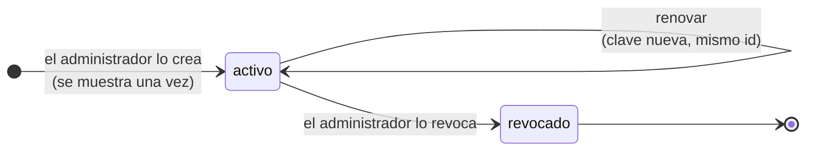

# Autenticación

Todas las rutas de la API piden una credencial en la cabecera `Authorization`:

```http
Authorization: Bearer dte_xxxxxxxxxxxx
```

## Dos tipos de credencial

Cada instancia de Faro atiende a **una empresa** y reconoce dos roles:

| | Administrador | Integración |
|---|---|---|
| **Quién** | Una persona que opera la instancia | Un sistema: punto de venta, tienda web, ERP |
| **Credencial** | Usuario y contraseña, que dan un JWT de 60 minutos | Token `dte_…` que no vence |
| **Cómo se obtiene** | `POST /api/v1/auth/login` | Lo crea el administrador con `POST /api/v1/apikeys` |
| **Para qué** | Configurar la empresa (datos, certificado, ambiente) y operar la instancia: tokens, auditoría, alertas | Emitir, enviar y consultar documentos; ver la empresa y sus folios; cargar CAF |

**Tu sistema usa un token de integración**, no la contraseña de una persona: no vence, no depende
de que alguien cambie su clave y queda identificado en la auditoría.

!!! tip "Un token por sistema"
    Si la empresa tiene un punto de venta y una tienda web, pide **dos** tokens. Así la auditoría
    dice cuál hizo qué y puedes revocar uno sin cortar el otro.

## Qué puede hacer un token de integración

| Puede | No puede (responde `403`) |
|---|---|
| Emitir, previsualizar, enviar y consultar sus documentos (`/api/v1/dte/…`) | Crear usuarios ni gestionar otros tokens |
| Ver la empresa, su ambiente y sus folios (`GET /api/v1/empresa`, `GET /api/v1/empresa/folios`) | Cambiar los datos de la empresa, su certificado o su ambiente |
| Cargar y listar CAF (`POST /api/v1/caf`, `GET /api/v1/caf`) | Fijar a mano el CAF en uso |
| Consultar indicadores (UF, UTM, dólar) | Ver la auditoría, las alertas y el listado general de documentos |
| Renovar **su propio** token | Crear usuarios ni gestionar otros tokens |

## Qué hace el administrador

La empresa se configura pocas veces y con cuidado, así que lo hace una persona con su usuario y
contraseña, no un sistema. Solo el administrador puede:

| Tarea | Llamada | Guía |
|---|---|---|
| Crear la empresa y mantener sus datos | `PUT /api/v1/empresa` | [Configurar la empresa](../guias/configurar-empresa.md) |
| Subir o reemplazar el certificado digital | `PUT /api/v1/empresa/certificado` | [Configurar la empresa](../guias/configurar-empresa.md#2-subir-el-certificado-digital) |
| Pasar de demo a certificación y a producción | `PUT /api/v1/empresa/ambiente` | [Pasar a producción](../guias/pasar-a-produccion.md) |
| Fijar a mano el CAF en uso | `PUT /api/v1/caf/{id}/en-uso` | [Configurar la empresa](../guias/configurar-empresa.md#varios-caf-del-mismo-tipo) |
| Crear, renovar y revocar tokens | `/api/v1/apikeys` | Esta página |
| Ver la auditoría, las alertas y todos los documentos | `/api/v1/auditoria`, `/api/v1/dte/alertas`, `/api/v1/dte/documentos` | [Rutas](../referencia/rutas.md#solo-administrador) |

Cada cambio queda en la auditoría con quién lo hizo. Un token de integración que llama una de
estas rutas recibe `403`.

**Cada token ve solo los documentos que emitió.** Si pide uno ajeno, recibe `404`, no `403`, para
no revelar que el documento existe.

## El administrador y su primer acceso

Una instancia nace con **un solo usuario**: `admin`. Lo crea Faro en el primer arranque, con la
contraseña de `ADMIN_PASSWORD` del servidor o, si no está definida, con una aleatoria que
aparece **una sola vez** en el log. Quien instala la instancia se la entrega al administrador.

El administrador entra así:

```bash
curl -s -X POST "$FARO_URL/api/v1/auth/login" \
  -H "Content-Type: application/json" \
  -d '{"username": "admin", "password": "<contraseña del administrador>"}'
```

La respuesta trae `access_token`, un JWT que dura 60 minutos. En los ejemplos del manual va en
`$FARO_ADMIN`. Cuando vence, se vuelve a iniciar sesión.

## Crear un token de integración

El administrador crea **un token por sistema** que se conecta a Faro:

```bash
curl -s -X POST "$FARO_URL/api/v1/apikeys" \
  -H "Authorization: Bearer $FARO_ADMIN" \
  -H "Content-Type: application/json" \
  -d '{"nombre": "punto-de-venta"}'
```

```json
{"api_key": "dte_xxxxxxxxxxxx", "id": 3, "nombre": "punto-de-venta", "aviso": "..."}
```

`api_key` es el token. **Se muestra solo en esta respuesta**: Faro guarda una huella, no la
clave. Entrégalo al equipo del sistema por un canal seguro; ellos lo guardan como secreto
(`$FARO_TOKEN` en los ejemplos). Si se pierde, se renueva o se crea otro.

## Ciclo de vida de un token



### Renovar (rutina)

Renueva el token cada cierto tiempo, o cuando cambie quien tiene acceso a él. Puedes hacerlo tú
mismo, con el token actual:

```bash
curl -s -X POST "$FARO_URL/api/v1/apikeys/propia/renovar" \
  -H "Authorization: Bearer $FARO_TOKEN"
```

La respuesta trae la clave nueva en `api_key`. **La anterior deja de funcionar en ese instante**, sin período de
gracia:

1. Guarda la clave nueva en el almacén de secretos de tu sistema.
2. Recién entonces, cambia la configuración para usarla.

El `id` del token no cambia, así que tus documentos y tus `id_externo` siguen siendo tuyos.

### Revocar (emergencia)

Si un token se filtró, el administrador lo revoca con `DELETE /api/v1/apikeys/{id}`. Deja de
funcionar al instante y no se puede reactivar: se crea uno nuevo.

## Límites de seguridad

| Situación | Qué pasa |
|---|---|
| 5 inicios de sesión fallidos para un usuario desde una IP | Ese usuario queda bloqueado 15 minutos desde esa IP |
| 20 tokens inválidos desde una IP | Los siguientes inválidos reciben `429`. Los válidos siguen funcionando. |

Una respuesta `429` trae la cabecera `Retry-After` con los segundos que debes esperar. Respétala:
reintentar antes alarga el bloqueo.

## Errores de autenticación

| HTTP | `codigo` | Causa | Qué hacer |
|---|---|---|---|
| 401 | `autenticacion` | Falta la cabecera, el token está mal copiado, fue renovado o revocado | Revisa el token. Si lo renovaste, usa la clave nueva. |
| 403 | `autorizacion` | El token no tiene permiso para esa ruta | Es una ruta de administrador. Pídesela a quien opera la instancia. |
| 429 | `demasiadas_solicitudes` | Demasiados intentos fallidos | Espera los segundos de `Retry-After`. |

## Buenas prácticas

- Guarda el token en un almacén de secretos o una variable de entorno, nunca en el código.
- No lo escribas en los logs de tu sistema.
- Usa siempre la URL interna de la instancia: Faro no debe quedar expuesto a Internet.
