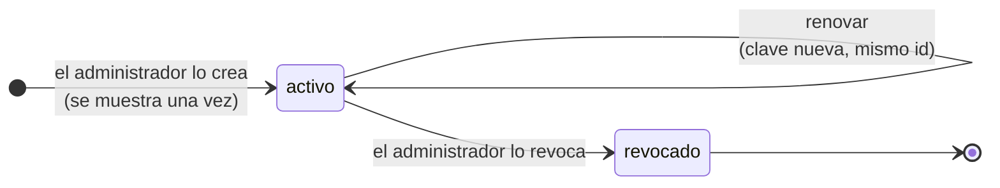

# Autenticación

Todas las rutas de la API piden una credencial en la cabecera `Authorization`:

```http
Authorization: Bearer dte_xxxxxxxxxxxx
```

## Dos tipos de credencial

Cada instancia de Faro atiende a **una empresa** y reconoce dos roles:

| | Administrador | Integración |
|---|---|---|
| **Quién** | Una persona que opera la instancia | Un sistema: punto de venta, tienda web, ERP |
| **Credencial** | Usuario y contraseña, que dan un JWT de 60 minutos | Token `dte_…` que no vence |
| **Cómo se obtiene** | `POST /api/v1/auth/login` | Lo crea el administrador con `POST /api/v1/apikeys` |
| **Para qué** | Todo: usuarios, tokens, auditoría, alertas | Emitir, enviar y consultar documentos; gestionar certificados, CAF y datos de la empresa |

**Tu sistema usa un token de integración**, no la contraseña de una persona: no vence, no depende
de que alguien cambie su clave y queda identificado en la auditoría.

!!! tip "Un token por sistema"
    Si la empresa tiene un punto de venta y una tienda web, pide **dos** tokens. Así la auditoría
    dice cuál hizo qué y puedes revocar uno sin cortar el otro.

## Qué puede hacer un token de integración

| Puede | No puede (responde `403`) |
|---|---|
| Emitir, previsualizar, enviar y consultar sus documentos (`/api/v1/dte/…`) | Crear usuarios ni gestionar otros tokens |
| Gestionar certificados, datos de la empresa, CAF y folios | Ver la auditoría |
| Consultar folios restantes e indicadores (UF, UTM, dólar) | Ver las alertas y el listado general de documentos |
| Renovar **su propio** token | Usar las rutas de administración |

**Cada token ve solo los documentos que emitió.** Si pide uno ajeno, recibe `404`, no `403`, para
no revelar que el documento existe.

## Ciclo de vida de un token



### Renovar (rutina)

Renueva el token cada cierto tiempo, o cuando cambie quien tiene acceso a él. Puedes hacerlo tú
mismo, con el token actual:

```bash
curl -s -X POST "$FARO_URL/api/v1/apikeys/propia/renovar" \
  -H "Authorization: Bearer $FARO_TOKEN"
```

La respuesta trae la clave nueva en `api_key`. **La anterior deja de funcionar en ese instante**, sin período de
gracia:

1. Guarda la clave nueva en el almacén de secretos de tu sistema.
2. Recién entonces, cambia la configuración para usarla.

El `id` del token no cambia, así que tus documentos y tus `id_externo` siguen siendo tuyos.

### Revocar (emergencia)

Si un token se filtró, el administrador lo revoca con `DELETE /api/v1/apikeys/{id}`. Deja de
funcionar al instante y no se puede reactivar: se crea uno nuevo.

## Límites de seguridad

| Situación | Qué pasa |
|---|---|
| 5 inicios de sesión fallidos para un usuario desde una IP | Ese usuario queda bloqueado 15 minutos desde esa IP |
| 20 tokens inválidos desde una IP | Los siguientes inválidos reciben `429`. Los válidos siguen funcionando. |

Una respuesta `429` trae la cabecera `Retry-After` con los segundos que debes esperar. Respétala:
reintentar antes alarga el bloqueo.

## Errores de autenticación

| HTTP | `codigo` | Causa | Qué hacer |
|---|---|---|---|
| 401 | `autenticacion` | Falta la cabecera, el token está mal copiado, fue renovado o revocado | Revisa el token. Si lo renovaste, usa la clave nueva. |
| 403 | `autorizacion` | El token no tiene permiso para esa ruta | Es una ruta de administrador. Pídesela a quien opera la instancia. |
| 429 | `demasiadas_solicitudes` | Demasiados intentos fallidos | Espera los segundos de `Retry-After`. |

## Buenas prácticas

- Guarda el token en un almacén de secretos o una variable de entorno, nunca en el código.
- No lo escribas en los logs de tu sistema.
- Usa siempre la URL interna de la instancia: Faro no debe quedar expuesto a Internet.
