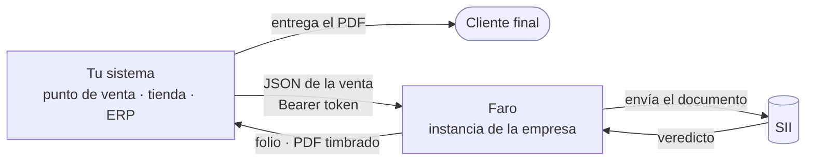
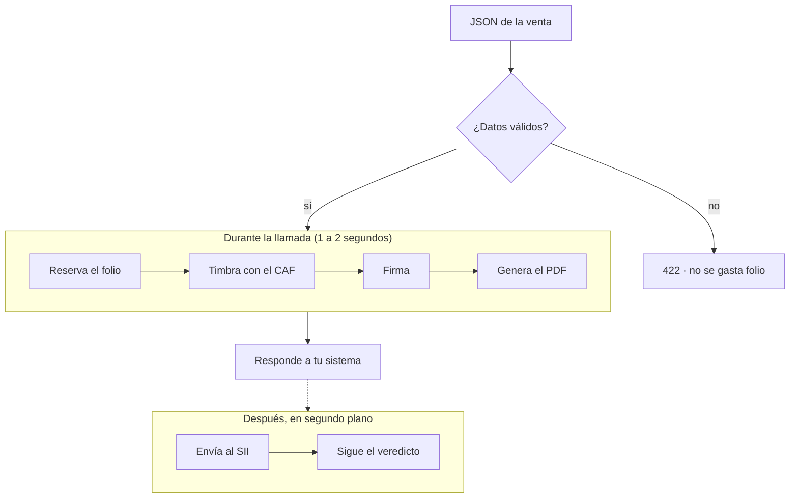
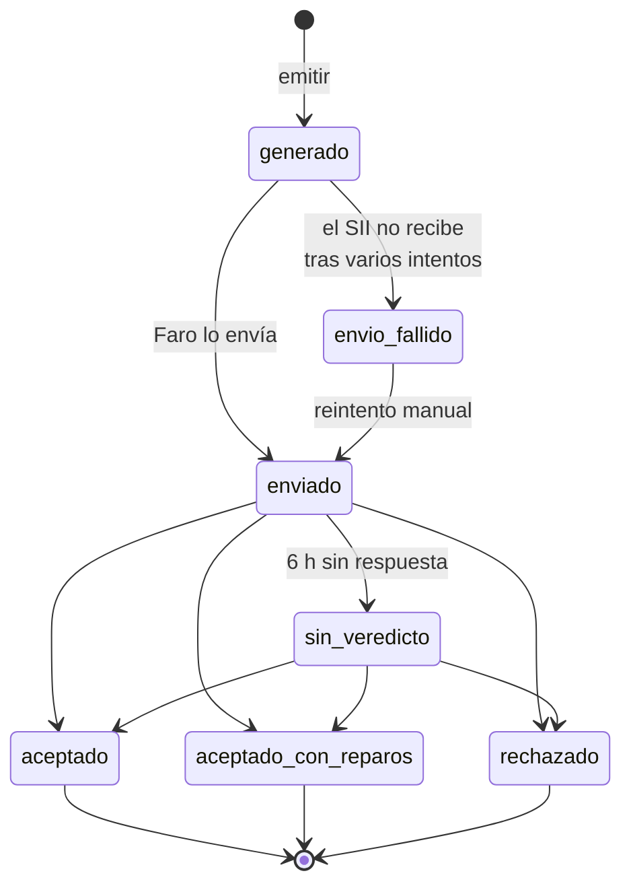

# Cómo funciona

Antes de escribir código conviene entender tres cosas:

- quién participa;
- por qué el SII responde tarde;
- qué hace Faro por tu sistema.

Con eso, el resto del manual se lee solo.

## Los actores



| Actor | Qué hace |
|---|---|
| **Tu sistema** | Registra la venta y llama a Faro. Entrega el PDF al cliente. |
| **Faro** | Asigna el folio, arma y firma el documento, genera el PDF, lo envía al SII y sigue su veredicto. Corre en la red interna de la empresa: no está expuesto a Internet. |
| **SII** | La autoridad tributaria. Recibe cada documento y lo acepta o lo rechaza. |
| **Cliente final** | Recibe la boleta o factura. |

## Chile no valida en línea

En muchos países el flujo es **síncrono**: envías el documento y la misma respuesta dice si la
autoridad lo aceptó. En Chile el SII funciona como una **oficina de recepción**: recibe el
documento, entrega un comprobante (el TrackID) y lo revisa después.

=== "Chile con Faro"

    ```mermaid
    sequenceDiagram
        participant S as Tu sistema
        participant F as Faro
        participant SII as SII
        S->>F: 1 · Emitir
        F-->>S: Folio + PDF al instante
        F->>SII: Envía el documento
        SII-->>F: TrackID (recibido)
        Note over SII: Revisa el documento
        SII-->>F: Veredicto (más tarde)
        S->>F: 2 · Consultar estado
        F-->>S: Aceptado / rechazado
    ```

=== "Otros países (síncrono)"

    ```mermaid
    sequenceDiagram
        participant S as Tu sistema
        participant A as Autoridad
        S->>A: Envía el documento
        A-->>S: Aceptado / rechazado
    ```

**Para tu sistema la experiencia es casi la misma: dos URL por documento.** La diferencia es que
la segunda (el estado) puede tardar en tener un veredicto final:

| Tipo de documento | Tiempo típico hasta el veredicto |
|---|---|
| Boletas (39, 41) | Segundos a pocos minutos |
| Facturas y notas (33, 34, 56, 61) | Minutos a horas |

!!! tip "Lo que esto significa para tu diseño"
    No dejes al usuario esperando el veredicto en pantalla. Emite, entrega el PDF y sigue con la
    siguiente venta. Consulta el estado en segundo plano (un proceso programado, una cola) o
    cuando alguien lo necesite.

## Qué hace Faro por ti

Todo lo que el SII exige y tu sistema no necesita saber:



- **Folios.** Cada documento lleva un número correlativo autorizado por el SII (el folio). Faro
  lleva la cuenta y asigna el siguiente sin choques, aunque lleguen muchas ventas a la vez.
- **Timbre y firma.** Faro timbra con el CAF (el archivo que autoriza los folios) y firma con el
  certificado digital de la empresa, que guarda cifrado. Tu sistema nunca maneja el certificado.
- **Validación previa.** Si el JSON tiene un error (RUT inválido, falta un dato, montos
  imposibles), Faro responde 422 **antes** de gastar un folio.
- **Envío y seguimiento.** Faro envía cada documento al SII, reintenta si el SII no responde y
  pregunta por el veredicto hasta tenerlo.

## El ciclo de vida de un documento

Cada documento pasa por estos estados. Tu sistema los lee en `GET /api/v1/dte/{dte_id}/estado`.



El significado de cada estado y qué hacer en cada uno está en [Estados](../referencia/estados.md).

## Una regla que conviene grabarse

!!! warning "Timbrado es emitido"
    Cuando Faro responde con un folio, el documento **ya existe** para efectos tributarios. No se
    borra ni se edita. Si tiene un error, se corrige con otro documento: una nota de crédito o de
    débito. Ver [Corregir o anular](../guias/corregir-anular.md).

Por eso Faro valida todo lo posible **antes** de asignar el folio, y por eso cada venta lleva un
`id_externo`: si repites la llamada, recibes el mismo documento en vez de uno duplicado. Ver
[Reintentos e idempotencia](../guias/idempotencia.md).
