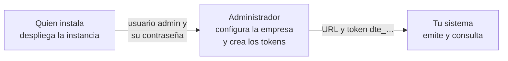

# Primeros pasos

En esta guía emites tu primera factura contra una instancia de pruebas, descargas el PDF y
consultas su estado.

## Quién hace qué

Hay dos personas (a veces la misma) y cada una usa su credencial:



1. **Quien instala** la instancia crea, en el primer arranque, el único usuario: `admin`. Su
   contraseña es la de `ADMIN_PASSWORD` del servidor o, si no la definió, una aleatoria que sale
   **una sola vez** en el log. Se la entrega al administrador.
2. **El administrador** entra con ese usuario, configura la empresa
   ([Configurar la empresa](../guias/configurar-empresa.md)) y **crea un token de integración**
   para tu sistema ([Crear un token](autenticacion.md#crear-un-token-de-integracion)).
3. **Tu sistema** usa ese token en cada llamada. Nunca usa la contraseña del administrador.

## Antes de empezar

Pide al administrador de Faro:

- [x] **La URL de la instancia**, por ejemplo `http://faro-acme:8000`. Es una dirección de la red
  interna: tu sistema debe correr en esa misma red.
- [x] **Un token de integración** (empieza con `dte_`). El administrador lo crea para tu sistema
  y se muestra una sola vez: guárdalo como un secreto, nunca en el código ni en el repositorio.
- [x] **La empresa configurada** (datos del emisor, certificado y CAF).

Si tú eres el administrador, haz primero
[Crear un token de integración](autenticacion.md#crear-un-token-de-integracion) y
[Configurar la empresa](../guias/configurar-empresa.md).

Para aprender y desarrollar, lo normal es la empresa en **modo demo**: emite documentos
completos, pero nada sale al SII. Ver [Ambientes](../referencia/ambientes.md).

En los ejemplos se usan estas variables:

```bash
export FARO_URL=http://faro-acme:8000
export FARO_TOKEN=dte_xxxxxxxxxxxx
```

## 1. Comprueba tu token

```bash
curl -s "$FARO_URL/api/v1/auth/me" -H "Authorization: Bearer $FARO_TOKEN"
```

```json
{"tipo": "apikey", "id": 3, "nombre": "punto-de-venta", "rol": "integracion"}
```

Si recibes `401`, el token es incorrecto o fue revocado. Ver [Autenticación](autenticacion.md).

## 2. Emite una factura

=== "curl"

    ```bash
    curl -s -X POST "$FARO_URL/api/v1/dte/emitir" \
      -H "Authorization: Bearer $FARO_TOKEN" \
      -H "Content-Type: application/json" \
      -d '{
        "id_externo": "pedido-1042",
        "dte": {
          "tipo_dte": 33,
          "receptor": {
            "rut": "76111111-6",
            "razon_social": "CLIENTE DEMO LTDA",
            "giro": "Comercio",
            "direccion": "Av. Siempreviva 742",
            "comuna": "Santiago"
          },
          "items": [
            {"numero_linea": 1, "nombre": "Servicio mensual", "cantidad": 1, "precio_unitario": 10000}
          ]
        }
      }'
    ```

=== "Python"

    ```python
    import os
    import requests

    FARO_URL = os.environ["FARO_URL"]
    cabeceras = {"Authorization": f"Bearer {os.environ['FARO_TOKEN']}"}

    venta = {
        "id_externo": "pedido-1042",
        "dte": {
            "tipo_dte": 33,
            "receptor": {
                "rut": "76111111-6",
                "razon_social": "CLIENTE DEMO LTDA",
                "giro": "Comercio",
                "direccion": "Av. Siempreviva 742",
                "comuna": "Santiago",
            },
            "items": [
                {"numero_linea": 1, "nombre": "Servicio mensual", "cantidad": 1, "precio_unitario": 10000}
            ],
        },
    }

    r = requests.post(f"{FARO_URL}/api/v1/dte/emitir", json=venta, headers=cabeceras, timeout=60)
    r.raise_for_status()
    documento = r.json()
    print(documento["dte_id"], documento["folio"], documento["estado"])
    ```

=== "JavaScript"

    ```javascript
    const FARO_URL = process.env.FARO_URL;
    const cabeceras = {
      Authorization: `Bearer ${process.env.FARO_TOKEN}`,
      "Content-Type": "application/json",
    };

    const venta = {
      id_externo: "pedido-1042",
      dte: {
        tipo_dte: 33,
        receptor: {
          rut: "76111111-6",
          razon_social: "CLIENTE DEMO LTDA",
          giro: "Comercio",
          direccion: "Av. Siempreviva 742",
          comuna: "Santiago",
        },
        items: [{ numero_linea: 1, nombre: "Servicio mensual", cantidad: 1, precio_unitario: 10000 }],
      },
    };

    const r = await fetch(`${FARO_URL}/api/v1/dte/emitir`, {
      method: "POST",
      headers: cabeceras,
      body: JSON.stringify(venta),
    });
    if (!r.ok) throw new Error(JSON.stringify(await r.json()));
    const documento = await r.json();
    console.log(documento.dte_id, documento.folio, documento.estado);
    ```

Respuesta (resumida):

```json
{
  "dte_id": 81,
  "folio": 1042,
  "tipo_dte": 33,
  "monto_total": 11900,
  "estado": "generado",
  "envio": "simulacion",
  "id_externo": "pedido-1042",
  "repetido": false,
  "ambiente": "simulacion",
  "mensaje": "DTE emitido. Folio 1042."
}
```

Fíjate en tres cosas:

- **No mandaste los datos de tu empresa** (`emisor`). Faro los toma de la configuración de la
  empresa.
- **El precio de la factura es neto.** Faro calculó el IVA: 10.000 + 1.900 = 11.900.
- **`envio: "simulacion"`** indica que la empresa está en modo demo y el documento no se envía
  al SII. En certificación y producción verás `"programado"`.

## 3. Descarga el PDF

```bash
curl -s "$FARO_URL/api/v1/dte/documentos/81/pdf" \
  -H "Authorization: Bearer $FARO_TOKEN" -o factura-1042.pdf
```

El PDF lleva el timbre electrónico (el código de barras) y ya es el documento que se entrega.

## 4. Consulta el estado

```bash
curl -s "$FARO_URL/api/v1/dte/81/estado" -H "Authorization: Bearer $FARO_TOKEN"
```

Respuesta (resumida):

```json
{"dte_id": 81, "folio": 1042, "estado": "generado", "track_id": null,
 "motivo_sii": null, "envio_sii": "desactivado"}
```

En modo demo, el estado se queda en `generado`. En una instancia que envía al SII
verás pasar el documento a `enviado` y luego a `aceptado` (o `rechazado`). Ver
[Seguir el veredicto del SII](../guias/seguir-veredicto.md).

## 5. Repite la llamada

Ejecuta otra vez el paso 2, idéntico. La respuesta trae el **mismo** `dte_id` y el mismo folio,
con `"repetido": true`. Así Faro te protege de duplicar una factura si tu sistema no recibió la
primera respuesta. Ver [Reintentos e idempotencia](../guias/idempotencia.md).

## Siguientes pasos

- [Emitir un documento](../guias/emitir.md): todos los tipos, montos, descuentos y referencias.
- [Seguir el veredicto del SII](../guias/seguir-veredicto.md): cómo y cada cuánto consultar.
- [Errores](../referencia/errores.md): cómo leer una respuesta de error.
