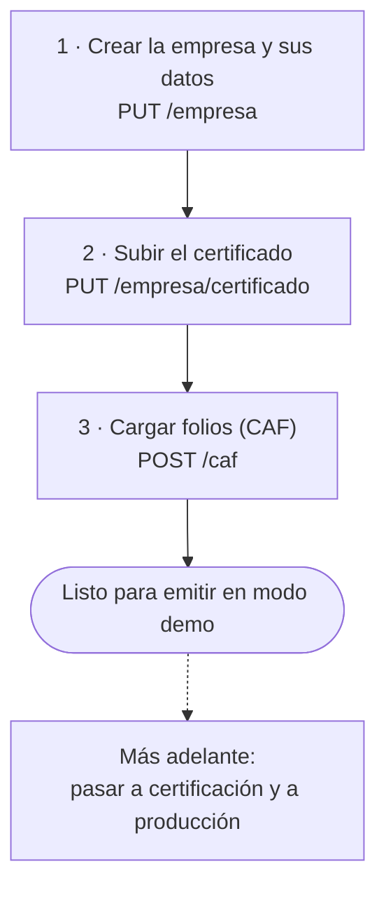

# Configurar la empresa

Una instancia de Faro atiende a **una sola empresa**. Antes de emitir necesita tres cosas: sus
**datos de emisor**, su **certificado digital** y **folios autorizados** (CAF). Se configura una
vez; después tu sistema solo emite.

Lo hace el **administrador** de la instancia (usuario con login):

| Paso | Administrador | Token de integración |
|---|:-:|:-:|
| Crear la empresa y cambiar sus datos | sí | no (`403`) |
| Subir el certificado | sí | no (`403`) |
| Cambiar de ambiente | sí | no (`403`) |
| Cargar un CAF | sí | sí |
| Fijar a mano el CAF en uso | sí | no (`403`) |
| Ver la empresa y sus folios | sí | sí |



La empresa nace en **modo demo** (`ambiente: "simulacion"`): emite, firma, timbra y entrega el
PDF como siempre, pero nada sale al SII ni se le consulta nada. Sirve para aprender la API y
construir la integración con datos ficticios. El paso a certificación y a producción es una
acción aparte: ver [Pasar a producción](pasar-a-produccion.md).

!!! note "Instancias que nacen en certificación"
    Quien instala la instancia puede hacer que la empresa nazca directo en certificación
    (`SII_AMBIENTE` del servidor). En ese caso el RUT se valida en el SII al crearla.

## 1. Crear la empresa y sus datos

```bash
curl -s -X PUT "$FARO_URL/api/v1/empresa" \
  -H "Authorization: Bearer $FARO_ADMIN" \
  -H "Content-Type: application/json" \
  -d '{
    "rut": "77777777-7",
    "razon_social": "EMPRESA DEMO SPA",
    "giro": "Venta de artículos de oficina",
    "codigo_actividad": 474100,
    "direccion": "Calle Ficticia 123",
    "comuna": "Santiago",
    "ciudad": "Santiago",
    "email": "facturacion@example.com"
  }'
```

`rut` solo hace falta la primera vez. La misma llamada, sin `rut`, actualiza los datos después.

En modo demo Faro solo revisa que el RUT esté bien formado (dígito verificador): no pregunta al
SII, así que la razón social la envías tú. El RUT se valida en el SII cuando la empresa pasa a
certificación; si falta la razón social, en ese momento se completa con la del SII.

| Campo | Obligatorio | Largo máximo | Nota |
|---|:-:|:-:|---|
| `rut` | al crear | — | Sin puntos y con guion |
| `razon_social` | sí | 100 | En demo la envías tú; fuera de demo, si falta, viene del SII |
| `giro` | sí | 80 | Actividad de la empresa, como aparece en el SII |
| `codigo_actividad` | sí | — | Código de actividad económica del SII (6 dígitos) |
| `direccion` | sí | 70 | Dirección de la casa matriz |
| `comuna` | sí | 20 | |
| `ciudad` | sí | 20 | |
| `email` | no | 80 | |
| `telefono` | no | 20 | |

Los campos que no envías no cambian. Un texto vacío (`""`) borra el dato.

Con el RUT de otra empresa responde `409` con `codigo: "empresa_unica"`: cada empresa tiene su
propia instancia.

## 2. Subir el certificado digital

El certificado (`.pfx` o `.p12`) es la firma electrónica de una persona autorizada por la
empresa. Faro lo valida con su contraseña y lo guarda **cifrado**. Tu sistema no vuelve a
manejarlo.

```bash
curl -s -X PUT "$FARO_URL/api/v1/empresa/certificado" \
  -H "Authorization: Bearer $FARO_ADMIN" \
  -F "archivo=@firma.pfx" \
  -F "password=<contraseña del certificado>" \
  -F "nombre=Firma representante legal"
```

La respuesta trae el RUT del titular, la fecha de vencimiento y si está vigente. Nunca devuelve
el certificado ni la contraseña. Si la contraseña es incorrecta o el archivo no es un
certificado, responde `422` con `codigo: "certificado"`.

!!! warning "Vencimiento"
    Los certificados vencen (normalmente al año). Antes de esa fecha, sube el nuevo con la misma
    llamada: reemplaza al anterior.

## 3. Cargar los folios (CAF)

El CAF es un archivo XML que el SII entrega a la empresa y que autoriza un rango de folios para
**un** tipo de documento. Necesitas uno por cada tipo que vayas a emitir (por ejemplo, 33 y 61).

```bash
curl -s -X POST "$FARO_URL/api/v1/caf" \
  -H "Authorization: Bearer $FARO_TOKEN" \
  -F "archivo=@CAF_33_1_100.xml"
```

El CAF queda en el ambiente actual de la empresa. Los CAF de certificación y de producción son
**distintos**: el SII los entrega por separado y uno no sirve en el otro ambiente. En modo demo
se carga un CAF de prueba, que tampoco sirve fuera de demo.

Un CAF de otra empresa, de otro tipo, dañado o **vencido** responde `422` con `codigo: "caf"`.
Cargar dos veces el mismo CAF en el mismo ambiente responde `409` con `codigo: "caf_repetido"`.

### Varios CAF del mismo tipo

Puedes cargar un CAF nuevo antes de que se acabe el anterior. Faro los usa en orden, sin que tu
sistema haga nada:

1. Los folios salen del CAF **en uso**: el vigente que vence primero.
2. Cuando ese CAF se agota o vence, Faro pasa solo al siguiente.
3. El SII no necesita ningún aviso: cada documento lleva su CAF dentro del timbre.

!!! warning "Los CAF vencen a los 6 meses"
    El SII rechaza un documento timbrado con un CAF autorizado hace más de 6 meses. Faro no usa
    un CAF vencido: si es el único, la emisión responde `409 sin_folios` con `motivo: "vencido"`
    y no gasta el folio. Los folios que no alcanzaste a usar se anulan en el sitio del SII.

El administrador puede fijar a mano qué CAF se usa (`PUT /api/v1/caf/{id}/en-uso`). Solo hace
falta en casos especiales; lo normal es dejar que Faro elija.

### Ver los folios

```bash
curl -s "$FARO_URL/api/v1/empresa/folios" -H "Authorization: Bearer $FARO_TOKEN"
```

Por cada tipo de documento responde cuántos folios quedan (`disponibles`) y sus CAF, con el
rango, cuál está en uso (`en_uso`) y cuándo vence cada uno (`vence`).

!!! tip "Reposición automática"
    Según cómo esté configurada la instancia, Faro puede pedir folios nuevos al SII cuando quedan
    pocos (por defecto, para boletas). El SII limita cuántos folios entrega y cada cuánto, así que
    no conviene pedir de más.

## Comprobar que todo está listo

```bash
curl -s "$FARO_URL/api/v1/empresa" -H "Authorization: Bearer $FARO_TOKEN"
```

Responde los datos de la empresa, su `ambiente` (`simulacion`, `certificacion` o `produccion`),
el certificado y, en `produccion.falta`, lo que todavía falta para pasar a producción.

Una previsualización usa el certificado, los datos del emisor y el CAF sin gastar un folio. Si
responde `200`, la empresa está lista para emitir. Ver
[Previsualizar sin gastar folios](previsualizar.md).
