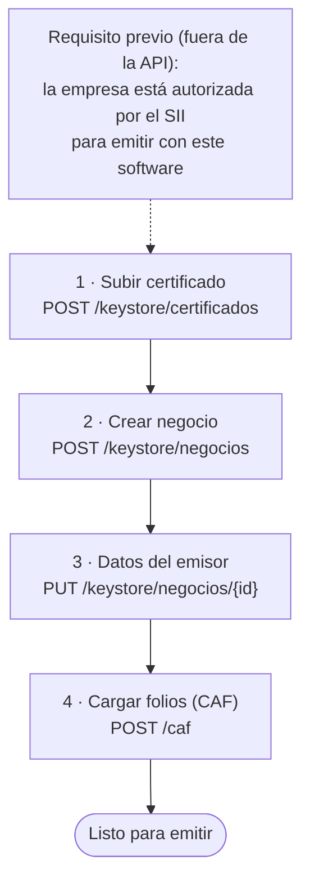

# Configurar la empresa

Antes de emitir, la instancia necesita tres cosas de la empresa: su **certificado digital**, sus
**datos de emisor** y **folios autorizados** (CAF). Se configura una vez; después tu sistema solo
emite.

Normalmente lo hace el administrador al dar de alta la instancia. Un token de integración también
puede hacerlo, por si tu sistema ofrece esta configuración en su propia interfaz.



!!! info "Requisito previo"
    La empresa debe estar autorizada por el SII como emisora electrónica con este software. Ese
    trámite (la certificación) tiene pasos manuales en el sitio del SII y lo coordina el
    administrador de Faro. Sin él, el SII rechaza los documentos.

## 1. Subir el certificado digital

El certificado (`.pfx` o `.p12`) es la firma electrónica de una persona autorizada por la
empresa. Se sube una vez; Faro lo valida con su contraseña y lo guarda **cifrado**. Tu sistema no
vuelve a manejarlo.

```bash
curl -s -X POST "$FARO_URL/api/v1/keystore/certificados" \
  -H "Authorization: Bearer $FARO_TOKEN" \
  -F "archivo=@firma.pfx" \
  -F "password=<contraseña del certificado>" \
  -F "nombre=Firma representante legal"
```

La respuesta (`201`) trae el `id` del certificado (`cert_id`), el RUT del titular y la fecha de
vencimiento. Nunca devuelve el certificado ni la contraseña.

Si la contraseña es incorrecta o el archivo no es un certificado, responde `422` con
`codigo: "certificado"`.

!!! warning "Vencimiento"
    Los certificados vencen (normalmente al año). Antes de esa fecha, sube el nuevo y asócialo al
    negocio; si no, Faro no podrá firmar.

## 2. Crear el negocio

El negocio es la empresa emisora dentro de Faro: su RUT, el certificado que la opera y el
ambiente del SII.

```bash
curl -s -X POST "$FARO_URL/api/v1/keystore/negocios" \
  -H "Authorization: Bearer $FARO_TOKEN" \
  -F "rut=77777777-7" \
  -F "cert_id=1" \
  -F "ambiente=certificacion"
```

| Campo | Valor |
|---|---|
| `rut` | RUT de la empresa, sin puntos y con guion |
| `cert_id` | El `id` del paso 1 |
| `ambiente` | `certificacion` (pruebas del SII) o `produccion` |

Faro completa la razón social consultando al SII. La respuesta trae el `id` del negocio.

## 3. Completar los datos del emisor

Son los datos que van impresos en cada documento. Con ellos, tu sistema no necesita mandar el
bloque `emisor` en cada emisión.

```bash
curl -s -X PUT "$FARO_URL/api/v1/keystore/negocios/1" \
  -H "Authorization: Bearer $FARO_TOKEN" \
  -H "Content-Type: application/json" \
  -d '{
    "giro": "Venta de artículos de oficina",
    "codigo_actividad": 474100,
    "direccion": "Calle Ficticia 123",
    "comuna": "Santiago",
    "ciudad": "Santiago",
    "email": "facturacion@example.com"
  }'
```

| Campo | Obligatorio | Largo máximo | Nota |
|---|:-:|:-:|---|
| `razon_social` | sí | 100 | Viene del SII; cámbiala solo si hace falta |
| `giro` | sí | 80 | Actividad de la empresa, como aparece en el SII |
| `codigo_actividad` | sí | — | Código de actividad económica del SII (6 dígitos) |
| `direccion` | sí | 70 | Dirección de la casa matriz o sucursal |
| `comuna` | sí | 20 | |
| `ciudad` | sí | 20 | |
| `email` | no | 80 | |
| `telefono` | no | 20 | |

Los campos que no envías no cambian. Un texto vacío (`""`) borra el dato.

Si emites sin `emisor` y a la empresa le falta alguno de los datos obligatorios, Faro responde
`422` y la lista de lo que falta viene en `detalle.faltan`.

## 4. Cargar los folios (CAF)

El CAF es un archivo XML que el SII entrega a la empresa y que autoriza un rango de folios para
**un** tipo de documento. Necesitas uno por cada tipo que vayas a emitir (por ejemplo, 33 y 61).

```bash
curl -s -X POST "$FARO_URL/api/v1/caf" \
  -H "Authorization: Bearer $FARO_TOKEN" \
  -F "archivo=@CAF_33_1001_1100.xml"
```

La respuesta trae el tipo, el rango (`folio_desde`, `folio_hasta`) y la fecha de autorización.
Un CAF de otra empresa, de otro tipo o dañado responde `422` con `codigo: "caf"`.

Para ver el siguiente folio y el rango del CAF en uso (quedan `folio_hasta - folio_disponible + 1`):

```bash
curl -s "$FARO_URL/api/v1/caf/folios/siguiente/77777777-7/33" \
  -H "Authorization: Bearer $FARO_TOKEN"
```

!!! tip "Reposición automática"
    Según cómo esté configurada la instancia, Faro puede pedir folios nuevos al SII cuando quedan
    pocos (por defecto, para boletas). El SII limita cuántos folios entrega y cada cuánto, así que
    no conviene pedir de más.

## Comprobar que todo está listo

Una previsualización usa el certificado, los datos del emisor y el CAF sin gastar un folio. Si
responde `200`, la empresa está lista para emitir. Ver
[Previsualizar sin gastar folios](previsualizar.md).
