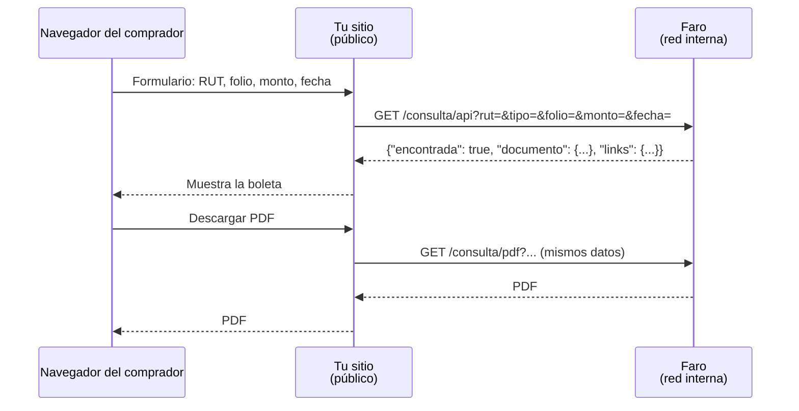

# Consulta pública de boletas

El SII exige que el comprador de una boleta pueda verificarla en línea. La dirección de esa
consulta va impresa en cada boleta. Faro trae lo necesario: una API **sin token**, de solo
lectura, que encuentra una boleta solo si se conocen sus datos reales.

Como Faro no está expuesto a Internet, la página pública la sirve **tu sistema**, y tu backend
llama a Faro por la red interna:



## Rutas

| Ruta | Devuelve |
|---|---|
| `GET /consulta/api?rut=&tipo=&folio=&monto=&fecha=` | JSON con la boleta, o `{"encontrada": false}` |
| `GET /consulta/pdf?…` | El PDF de la boleta (mismos parámetros) |
| `GET /consulta/xml?…` | El XML firmado (mismos parámetros) |

Un `tipo` distinto de 39 o 41 responde `400`. Una boleta que no existe con esos datos responde `{"encontrada": false}` (y `404` en `/pdf` y `/xml`).

| Parámetro | Descripción |
|---|---|
| `rut` | RUT del emisor |
| `tipo` | `39` (boleta) o `41` (boleta exenta) |
| `folio` | Folio impreso en la boleta |
| `monto` | Monto total impreso |
| `fecha` | Fecha de emisión `AAAA-MM-DD` (opcional, recomendada) |

```json
{
  "encontrada": true,
  "documento": {"tipo": 39, "tipo_nombre": "Boleta Electrónica", "folio": 731, "rut_emisor": "77777777-7",
                "fecha_emision": "2026-11-09", "monto_neto": 2000, "iva": 380, "monto_total": 2380, "...": "..."},
  "links": {"pdf": "/consulta/pdf?rut=77777777-7&tipo=39&folio=731&monto=2380", "xml": "/consulta/xml?..."}
}
```

## Reglas

- **Los `links` son relativos a Faro.** Tu backend descarga el archivo y lo entrega; no pongas esa
  dirección en el navegador del comprador.
- **Mantén el candado.** No ofrezcas búsquedas con menos datos de los que exige la API: es lo que
  impide que alguien recorra las boletas de la empresa.
- **La URL de tu página es la que se declara al SII** y la que va impresa en las boletas. Defínela
  antes de la certificación de boletas y no la cambies después.
