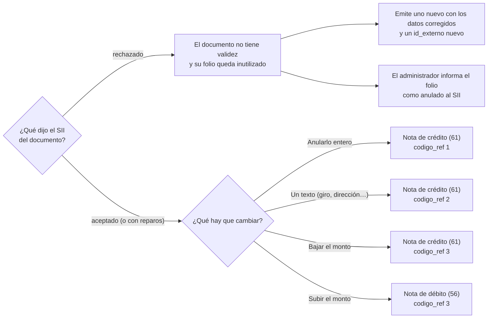

# Corregir o anular

Un documento timbrado no se borra ni se edita. Cómo se corrige depende de lo que dijo el SII.



## Si el SII lo rechazó

Un documento `rechazado` nunca tuvo validez, pero su folio ya se usó y **no se reenvía**.

1. Lee `motivo_sii` en el estado. En boletas trae el detalle; en facturas, el SII manda el detalle
   del rechazo por correo electrónico a la empresa.
2. Corrige los datos y **emite un documento nuevo** con un `id_externo` nuevo (por ejemplo
   `pedido-1042-r1`). Recibirá otro folio.
3. El folio rechazado aparece en las alertas de la instancia (`folios_por_anular`) para que el
   administrador lo informe como anulado en el sitio del SII.

!!! note "No hace falta una nota de crédito"
    Un documento rechazado no existe para el SII, así que no se anula con una nota: solo se
    reemplaza.

## Si el SII lo aceptó

Se corrige con **otro documento** que hace referencia al original:

- una **nota de crédito** (61) para anular, corregir textos o rebajar montos;
- una **nota de débito** (56) para aumentar montos.

### La referencia

Toda nota lleva `referencias`, con el documento que corrige:

| Campo | Descripción |
|---|---|
| `tipo_doc_ref` | Tipo del documento original (33, 34, 39, 41, 56 o 61) |
| `folio_ref` | Folio del documento original |
| `fecha_doc_ref` | Fecha de emisión del original (`AAAA-MM-DD`) |
| `codigo_ref` | `1` anula · `2` corrige texto · `3` corrige montos |
| `razon_ref` | Motivo, en texto libre (hasta 90 caracteres) |

Sin `referencias`, Faro responde `422` antes de gastar un folio.

!!! warning "Los precios de una nota son netos"
    Aunque corrija una boleta (cuyo precio incluye IVA), la nota lleva precios **netos**. Una
    boleta de $1.190 se anula con una nota de $1.000 neto (+ IVA = $1.190).

## Ejemplos

=== "Anular una factura"

    Anula por completo la factura 1042. Los ítems repiten los del original.

    ```json
    {
      "id_externo": "pedido-1042-anula",
      "dte": {
        "tipo_dte": 61,
        "receptor": {
          "rut": "76111111-6",
          "razon_social": "CLIENTE DEMO LTDA",
          "giro": "Comercio",
          "direccion": "Av. Siempreviva 742",
          "comuna": "Santiago"
        },
        "items": [
          {"numero_linea": 1, "nombre": "Servicio mensual", "cantidad": 1, "precio_unitario": 10000}
        ],
        "referencias": [
          {"tipo_doc_ref": 33, "folio_ref": 1042, "fecha_doc_ref": "2026-11-09",
           "codigo_ref": 1, "razon_ref": "Anula factura por pedido cancelado"}
        ]
      }
    }
    ```

=== "Anular una boleta"

    No existe un "borrar boleta": se anula con una nota de crédito que la referencia.

    ```json
    {
      "id_externo": "ticket-000731-anula",
      "dte": {
        "tipo_dte": 61,
        "receptor": {"rut": "66666666-6", "razon_social": "CONSUMIDOR FINAL", "es_contribuyente": false},
        "items": [
          {"numero_linea": 1, "nombre": "Anula boleta folio 731", "cantidad": 1, "precio_unitario": 2000}
        ],
        "referencias": [
          {"tipo_doc_ref": 39, "folio_ref": 731, "fecha_doc_ref": "2026-11-09",
           "codigo_ref": 1, "razon_ref": "Devolución del producto"}
        ]
      }
    }
    ```

    La boleta era de $2.380 con IVA; la nota lleva $2.000 neto.

=== "Rebajar el monto"

    Descuento posterior de $5.000 neto sobre la factura 1042.

    ```json
    {
      "id_externo": "pedido-1042-descuento",
      "dte": {
        "tipo_dte": 61,
        "receptor": {
          "rut": "76111111-6",
          "razon_social": "CLIENTE DEMO LTDA",
          "giro": "Comercio",
          "direccion": "Av. Siempreviva 742",
          "comuna": "Santiago"
        },
        "items": [
          {"numero_linea": 1, "nombre": "Descuento por pronto pago", "cantidad": 1, "precio_unitario": 5000}
        ],
        "referencias": [
          {"tipo_doc_ref": 33, "folio_ref": 1042, "fecha_doc_ref": "2026-11-09",
           "codigo_ref": 3, "razon_ref": "Descuento comercial posterior"}
        ]
      }
    }
    ```

=== "Corregir un texto"

    Corrige la dirección del receptor. La nota va **en cero**: no mueve montos.

    ```json
    {
      "id_externo": "pedido-1042-corrige-direccion",
      "dte": {
        "tipo_dte": 61,
        "receptor": {
          "rut": "76111111-6",
          "razon_social": "CLIENTE DEMO LTDA",
          "giro": "Comercio",
          "direccion": "Av. Siempreviva 744",
          "comuna": "Santiago"
        },
        "items": [
          {"numero_linea": 1, "nombre": "Corrige dirección del receptor", "cantidad": 1, "precio_unitario": 0}
        ],
        "referencias": [
          {"tipo_doc_ref": 33, "folio_ref": 1042, "fecha_doc_ref": "2026-11-09",
           "codigo_ref": 2, "razon_ref": "Dirección correcta: Av. Siempreviva 744"}
        ]
      }
    }
    ```

Las notas siguen el mismo ciclo que cualquier documento: se emiten, Faro las envía y su estado se
consulta igual. Si tienes dudas sobre qué código usar en un caso tributario concreto, consúltalo
con el contador de la empresa.
