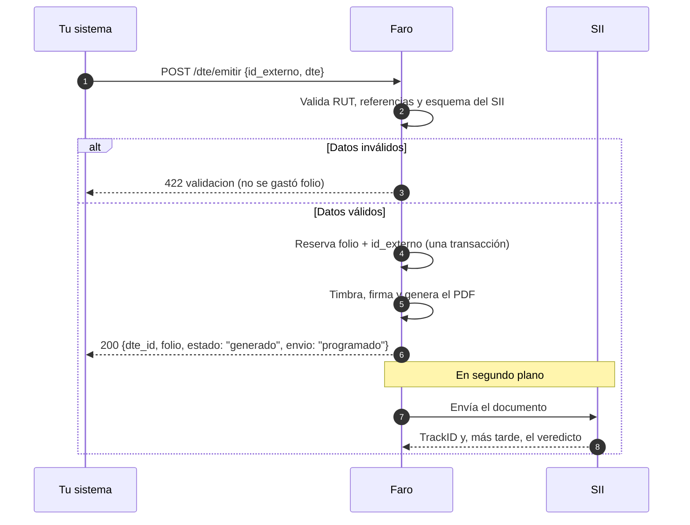
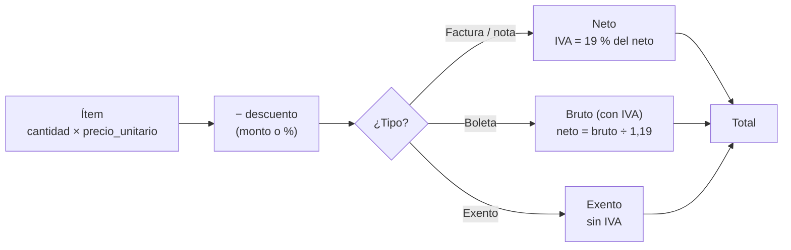

# Emitir un documento

`POST /api/v1/dte/emitir` convierte una venta en un documento tributario. Responde en uno o dos
segundos con el folio y el PDF timbrado. El envío al SII ocurre después, en segundo plano.

## Qué pasa dentro de una emisión



## La petición

```json
{
  "id_externo": "pedido-1042",
  "enviar": true,
  "dte": { ... }
}
```

| Campo | Tipo | Obligatorio | Descripción |
|---|---|:-:|---|
| `id_externo` | texto (1 a 100) | muy recomendado | El identificador de la venta en tu sistema (pedido, orden, ticket). Evita duplicados al reintentar. Ver [Reintentos e idempotencia](idempotencia.md). |
| `enviar` | booleano | no (`true`) | Con `true`, Faro envía el documento al SII y sigue su veredicto. Con `false`, lo envías tú. Ver [Enviar tú mismo al SII](envio-manual.md). |
| `dte` | objeto | sí | El documento. Detalle de cada campo en [El documento (JSON)](../referencia/documento.md). |

## Tipos de documento

| `tipo_dte` | Documento | Precio de los ítems | Receptor |
|:-:|---|---|---|
| 33 | Factura electrónica | Neto (sin IVA) | Empresa o persona con RUT, con giro y dirección |
| 34 | Factura exenta | Exento | Igual que 33 |
| 39 | Boleta electrónica | **Con IVA incluido** | Puede ser consumidor final |
| 41 | Boleta exenta | Exento | Puede ser consumidor final |
| 56 | Nota de débito | Neto | El mismo del documento que corrige |
| 61 | Nota de crédito | Neto | El mismo del documento que corrige |

Las notas de crédito y débito necesitan `referencias`. Ver [Corregir o anular](corregir-anular.md).

## Ejemplos

=== "Factura (33)"

    ```json
    {
      "id_externo": "pedido-1042",
      "dte": {
        "tipo_dte": 33,
        "receptor": {
          "rut": "76111111-6",
          "razon_social": "CLIENTE DEMO LTDA",
          "giro": "Comercio",
          "direccion": "Av. Siempreviva 742",
          "comuna": "Santiago"
        },
        "items": [
          {"numero_linea": 1, "nombre": "Resma papel carta", "cantidad": 10, "precio_unitario": 3500},
          {"numero_linea": 2, "nombre": "Despacho", "cantidad": 1, "precio_unitario": 5000, "descuento_pct": 50}
        ],
        "forma_pago": 2,
        "fecha_vencimiento": "2026-12-09"
      }
    }
    ```

    Totales: neto 35.000 + 2.500 = 37.500; IVA 7.125; total **44.625**.

=== "Boleta (39)"

    ```json
    {
      "id_externo": "ticket-000731",
      "dte": {
        "tipo_dte": 39,
        "receptor": {"rut": "66666666-6", "razon_social": "CONSUMIDOR FINAL", "es_contribuyente": false},
        "items": [
          {"numero_linea": 1, "nombre": "Café", "cantidad": 2, "precio_unitario": 1190}
        ]
      }
    }
    ```

    En boletas el precio **incluye IVA**: total **2.380** (neto 2.000, IVA 380).
    `66666666-6` es el RUT genérico para un consumidor final sin identificar.

=== "Factura con ítem exento"

    ```json
    {
      "id_externo": "pedido-1043",
      "dte": {
        "tipo_dte": 33,
        "receptor": {
          "rut": "76111111-6",
          "razon_social": "CLIENTE DEMO LTDA",
          "giro": "Comercio",
          "direccion": "Av. Siempreviva 742",
          "comuna": "Santiago"
        },
        "items": [
          {"numero_linea": 1, "nombre": "Asesoría", "cantidad": 1, "precio_unitario": 100000},
          {"numero_linea": 2, "nombre": "Curso de capacitación", "cantidad": 1, "precio_unitario": 50000, "exento": true}
        ]
      }
    }
    ```

    Totales: neto 100.000, IVA 19.000, exento 50.000; total **169.000**.

## Montos: lo que calcula Faro

Tu sistema manda **cantidad y precio unitario**; Faro calcula el resto con las reglas del SII.
No mandes totales.



- Los montos se redondean a pesos enteros (los ,5 hacia arriba).
- `descuento_monto` tiene prioridad sobre `descuento_pct` si mandas los dos.
- En una factura (33) puedes mezclar ítems afectos y exentos (`"exento": true`). En 34 y 41
  todo es exento.

## Datos del emisor

No hace falta mandarlos: Faro usa los de la empresa configurada (ver
[Configurar la empresa](configurar-empresa.md)).

- Si la instancia tiene **varias** empresas, indica cuál con `"rut_emisor": "77777777-7"` dentro
  de `dte`.
- Si mandas el bloque `emisor` completo, Faro usa ese en vez del configurado.

## La respuesta

```json
{
  "dte_id": 81,
  "folio": 1042,
  "tipo_dte": 33,
  "monto_total": 44625,
  "estado": "generado",
  "envio": "programado",
  "id_externo": "pedido-1042",
  "repetido": false,
  "xml_envio_b64": "PD94bWwg...",
  "ambiente": "produccion",
  "mensaje": "DTE emitido. Folio 1042."
}
```

| Campo | Qué es |
|---|---|
| `dte_id` | El identificador del documento en Faro. Guárdalo junto a tu venta: lo usas para el PDF y el estado. |
| `folio` | El número del documento ante el SII. |
| `monto_total` | El total calculado por Faro. Compáralo con el de tu sistema. |
| `estado` | Siempre `generado` al emitir. Ver [Estados](../referencia/estados.md). |
| `envio` | `programado`: Faro lo enviará. `no_solicitado`: mandaste `enviar: false`. `desactivado`: la instancia no envía al SII. En un reintento, el estado actual del documento. |
| `repetido` | `true` si el `id_externo` ya tenía este documento y no se creó uno nuevo. |
| `xml_envio_b64` | El XML firmado, en base64. Opcional: puedes archivarlo o descargarlo después. |
| `ambiente` | `certificacion` o `produccion`. |

La respuesta trae además `xml_dte_path`, `pdf_path` y `xml_envio_path`. Son rutas internas del
servidor: no las uses. El PDF y el XML se descargan con las rutas de
[Consultar lo emitido](consultar.md).

## Entregar el documento

El PDF está timbrado desde el primer momento:

```bash
curl -s "$FARO_URL/api/v1/dte/documentos/81/pdf" -H "Authorization: Bearer $FARO_TOKEN" -o doc.pdf
```

- **Boletas:** se entregan de inmediato (el PDF viene en formato de rollo de 80 mm).
- **Facturas:** el PDF es válido al emitir. Si tu proceso exige confirmar la aceptación del SII
  antes de enviarlo al cliente, espera el estado `aceptado`.

## Errores frecuentes al emitir

| HTTP | `codigo` | Causa | ¿Se gastó folio? | Qué hacer |
|---|---|---|:-:|---|
| 422 | `validacion` | RUT inválido, falta un dato, nota sin referencias, no cumple el esquema del SII | No | Corrige el JSON según `detalle.errores`. |
| 409 | `sin_folios` | No quedan folios del tipo pedido | No | Carga un CAF nuevo. |
| 409 | `en_curso` | Otra petición está emitiendo el mismo `id_externo` | No | Reintenta en unos segundos. |
| 409 | `ya_emitido` | El `id_externo` ya tiene un documento con **otros** datos | — | Ver [Reintentos e idempotencia](idempotencia.md). |
| 422 | `certificado` | El certificado de la empresa venció o no carga | No | El administrador debe subir uno vigente. |
| 500 | `error_emision` | Falló la generación después de reservar el folio | Reservado | Reintenta con el **mismo** `id_externo`: retoma esa emisión sin duplicarla. |

La lista completa está en [Errores](../referencia/errores.md).
