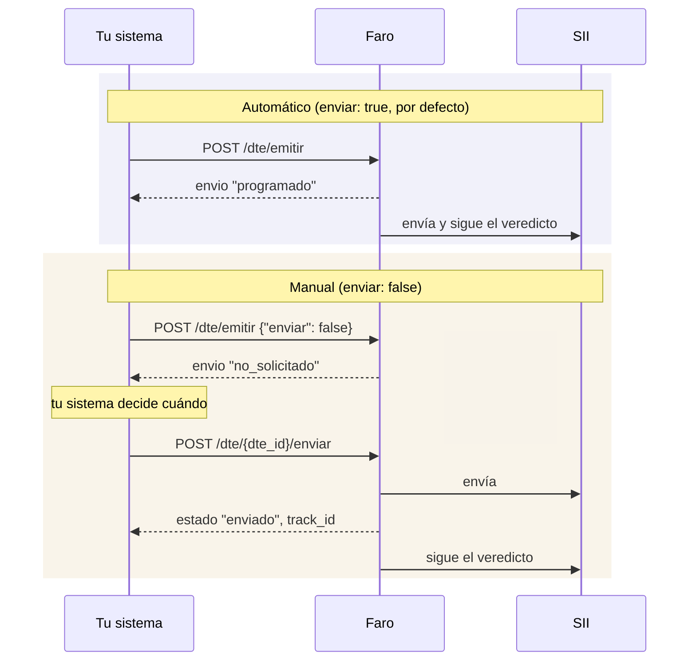

# Enviar tú mismo al SII

Por defecto Faro envía cada documento al SII apenas lo emite. Si tu sistema necesita decidir
**cuándo** sale cada documento (por ejemplo, después de que una persona lo revisa), puedes emitir
sin enviar y enviarlo después.

!!! tip "¿Lo necesitas?"
    En la mayoría de los casos no. El envío automático reintenta si el SII no responde y sigue el
    veredicto sin que hagas nada. Usa el envío manual solo si tu proceso lo exige.

## Comparación



## Pasos

| Paso | Llamada | Resultado |
|---|---|---|
| 1 | `POST /api/v1/dte/emitir` con `"enviar": false` | Folio y PDF. `envio: "no_solicitado"`, estado `generado` |
| 2 | `POST /api/v1/dte/{dte_id}/enviar` | Estado `enviado` con `track_id` |
| 3 | `GET /api/v1/dte/{dte_id}/estado` | El veredicto, cuando llegue. Faro lo sigue desde el paso 2 |

```bash
curl -s -X POST "$FARO_URL/api/v1/dte/81/enviar" -H "Authorization: Bearer $FARO_TOKEN"
```

```json
{"dte_id": 81, "folio": 1042, "estado": "enviado", "track_id": "4242", "motivo_sii": null, "...": "..."}
```

## Comportamiento de `POST /dte/{dte_id}/enviar`

| Situación | Respuesta |
|---|---|
| Documento `generado` | Lo envía. `200` con estado `enviado` |
| Documento `envio_fallido` | Reinicia los intentos y lo envía. `200` con estado `enviado` |
| Ya enviado o con veredicto | No lo reenvía. `200` con su estado actual |
| El SII no responde | `502 sii_comunicacion`. Faro lo dejará programado para reintentar |
| Otra petición lo está enviando | `409 en_curso` |
| La instancia no envía al SII | `409 envio_desactivado` |

Esta misma ruta sirve, con el envío automático, para **reintentar un `envio_fallido`** una vez
resuelto el problema (por ejemplo, un certificado vencido que ya se reemplazó).

!!! warning "Plazos del SII"
    El SII espera recibir cada documento dentro de plazos acotados desde su emisión. Si usas el
    envío manual, tu sistema es responsable de no dejar documentos sin enviar.
