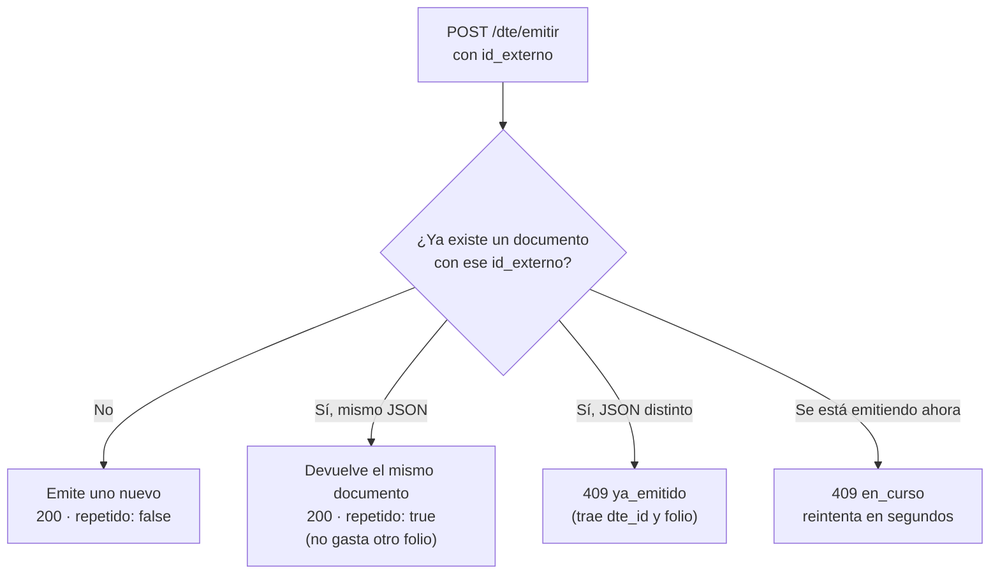

# Reintentos e idempotencia

Las redes fallan. Tu sistema puede mandar una emisión y no recibir la respuesta por un corte, un
tiempo de espera agotado o un reinicio. La pregunta es: **¿se emitió o no?** Si reintentas a
ciegas, puedes terminar con dos facturas por la misma venta.

El campo `id_externo` resuelve eso.

## Cómo funciona

`id_externo` es el identificador de la venta **en tu sistema**: el número de pedido, de orden o de
ticket. Faro lo asocia al documento que emite. Si llega otra vez:



| Situación | Respuesta | Qué hacer |
|---|---|---|
| Primera vez | `200`, `repetido: false` | Guardar `dte_id` |
| Reintento con el mismo JSON | `200`, `repetido: true`, mismo `dte_id` y folio | Igual que la primera vez |
| Mismo `id_externo`, otros datos | `409 ya_emitido` | Ver abajo |
| Otra petición con ese `id_externo` está en curso | `409 en_curso` | Esperar unos segundos y reintentar |
| La primera vez falló a mitad (`500 error_emision`) | — | Reintentar igual: Faro retoma la emisión pendiente sin duplicarla |

## Reglas para tu sistema

1. **Manda siempre `id_externo`.** Sin él, cada llamada es una emisión nueva.
2. **Un `id_externo` por venta**, único y estable. Si la venta se reintenta, el valor es el mismo.
3. **Reintenta con el mismo JSON.** Faro compara el contenido: si cambia algo, no lo trata como un
   reintento.
4. **Reintenta con espera creciente**, por ejemplo a los 2, 5 y 15 segundos.

```python
import time

import requests

def emitir_con_reintentos(faro, venta):
    for espera in (0, 2, 5, 15):
        time.sleep(espera)
        try:
            r = faro.post("/api/v1/dte/emitir", json=venta, timeout=60)
        except (requests.ConnectionError, requests.Timeout):
            continue                     # no hubo respuesta: reintentar es seguro
        if r.status_code == 409 and r.json()["error"]["codigo"] == "en_curso":
            continue                     # otra petición la está emitiendo
        if r.status_code == 500 and r.json()["error"]["codigo"] == "error_emision":
            continue                     # reintentar retoma la emisión pendiente
        return r                         # 200, 422, 409 ya_emitido...: decide tu sistema
    raise RuntimeError("Faro no respondió; revisar antes de volver a intentar")
```

## `ya_emitido`: la venta cambió después de emitir

Si tu sistema manda el mismo `id_externo` con datos distintos (otro monto, otro ítem), Faro
responde:

```json
{
  "error": {
    "codigo": "ya_emitido",
    "mensaje": "La venta pedido-1042 ya tiene el folio 1042 timbrado (estado aceptado). Un documento timbrado no cambia: corrígelo con una nota de crédito o débito.",
    "detalle": {"dte_id": 81, "folio": 1042, "estado": "aceptado"}
  }
}
```

El documento original **ya existe** y no se puede modificar. Las opciones son:

- **Era un error de tu sistema** (mandó datos distintos por un fallo): usa el documento que trae
  `detalle.dte_id`.
- **La venta cambió de verdad:** corrige el documento original con una nota de crédito o débito.
  Ver [Corregir o anular](corregir-anular.md).

## Alcance del `id_externo`

- Es único **por token**. Dos sistemas con tokens distintos pueden usar el mismo valor sin chocar.
- Renovar el token no cambia nada: el token conserva su identidad y sus `id_externo`.
- Un documento rechazado por el SII no libera su `id_externo`. Para emitir el reemplazo, usa uno
  nuevo, por ejemplo `pedido-1042-r1`.
