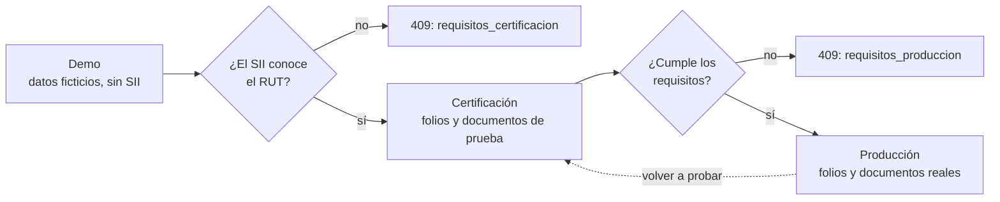

# Pasar a producción

La empresa recorre tres ambientes en la **misma instancia**. El **administrador** la pasa de
uno a otro con una llamada. No se instala nada ni se crea otra instancia, y tu sistema no
cambia: mismo token, mismas llamadas.



| Ambiente | `ambiente` | ¿Habla con el SII? | Para qué |
|---|---|---|---|
| **Demo** | `simulacion` | Nunca | Aprender la API y construir la integración con datos ficticios |
| **Certificación** | `certificacion` | Sí, con el SII de pruebas | Probar contra el SII, sin valor tributario |
| **Producción** | `produccion` | Sí, con el SII real | Operación real |

## De demo a certificación

En demo Faro no consulta al SII: la empresa se crea con cualquier RUT bien formado. Al pasar a
certificación empieza el contacto con el SII, así que **ahí se valida el RUT**.

```bash
curl -s -X PUT "$FARO_URL/api/v1/empresa/ambiente" \
  -H "Authorization: Bearer $FARO_ADMIN" \
  -H "Content-Type: application/json" \
  -d '{"ambiente": "certificacion", "confirmar_rut": "77777777-7"}'
```

- `200`: la empresa quedó en certificación. Si no tenía razón social, toma la del SII.
- `409` con `codigo: "requisitos_certificacion"`: el ambiente no cambió. `detalle.falta` dice por
  qué: `rut_sii` (el SII no muestra ese RUT en su ambiente de certificación, o no respondió; la
  empresa debe estar inscrita ahí) o `rut_ficticio` (es un RUT de demostración, como
  `77777777-7`: solo sirve en demo, aunque el SII lo liste como RUT de prueba).

Lo emitido en demo queda en demo: sus folios, documentos e `id_externo` no pasan a
certificación. Carga el CAF de certificación (`POST /api/v1/caf`) después del cambio, o antes
con `ambiente=certificacion`.

## Qué cambia y qué no

Certificación y producción son ambientes separados del SII. Cada uno entrega sus propios folios
y numera por su cuenta.

| | Qué pasa al cambiar |
|---|---|
| **Folios (CAF)** | Se usan solo los CAF de producción. Los de certificación quedan guardados y no se tocan |
| **Numeración** | Empieza donde diga el CAF de producción. El folio 1 de certificación y el folio 1 de producción son documentos distintos |
| **Documentos ya emitidos** | Quedan en su ambiente. Uno de certificación que espera veredicto se sigue consultando en el SII de pruebas |
| **`id_externo`** | Cada ambiente recuerda sus ventas: el `pedido-1` de las pruebas no choca con el `pedido-1` real |
| **Token, rutas y JSON** | No cambian |

## Requisitos

Faro no deja pasar a producción si falta algo de esta lista:

| Requisito | Cómo se cumple |
|---|---|
| Datos de la empresa completos | `PUT /api/v1/empresa` |
| Certificado digital vigente | `PUT /api/v1/empresa/certificado` |
| Un CAF de producción vigente y con folios | `POST /api/v1/caf` con `ambiente=produccion` |
| Configuración segura de la instancia | La revisa el administrador del servidor |
| La empresa está autorizada por el SII en producción | Terminar la certificación en el SII |

Para ver qué falta, sin cambiar nada:

```bash
curl -s "$FARO_URL/api/v1/empresa?consultar_sii=true" -H "Authorization: Bearer $FARO_ADMIN"
```

`produccion.puede` dice si ya se puede y `produccion.falta` lista lo pendiente.

## 1. Cargar el CAF de producción

Se carga **antes** del cambio, indicando el ambiente. No afecta a lo que se emite hoy.

```bash
curl -s -X POST "$FARO_URL/api/v1/caf" \
  -H "Authorization: Bearer $FARO_ADMIN" \
  -F "archivo=@CAF_33_produccion.xml" \
  -F "ambiente=produccion"
```

## 2. Cambiar el ambiente

```bash
curl -s -X PUT "$FARO_URL/api/v1/empresa/ambiente" \
  -H "Authorization: Bearer $FARO_ADMIN" \
  -H "Content-Type: application/json" \
  -d '{"ambiente": "produccion", "confirmar_rut": "77777777-7"}'
```

`confirmar_rut` es el RUT de la empresa, repetido: confirma que el cambio es a propósito.

- `200`: la empresa quedó en producción. Lo que se emita desde ahora es real.
- `409` con `codigo: "requisitos_produccion"`: no se cambió; `detalle.falta` dice qué falta.
- `422`: el RUT de confirmación no coincide, o el ambiente no existe.
- `403`: la llamada se hizo con un token de integración. Solo el administrador cambia el ambiente.

!!! danger "Desde este momento los documentos son reales"
    Un documento emitido en producción tiene valor tributario y no se borra: se corrige con una
    nota de crédito. Haz el cambio cuando tu sistema ya esté probado en certificación.

El cambio queda en la auditoría de la instancia, con quién lo hizo y cuándo.

## Volver a certificación o a demo

La misma llamada con `"ambiente": "certificacion"` o `"ambiente": "simulacion"`. No pide
requisitos. Sirve para probar algo nuevo; mientras tanto **no se emiten documentos reales**. Los
folios y documentos de producción quedan como estaban y se retoman al volver.

## Comprobar en qué ambiente está

Cada respuesta de emisión trae `ambiente`. También:

```bash
curl -s "$FARO_URL/api/v1/empresa" -H "Authorization: Bearer $FARO_TOKEN"
```
