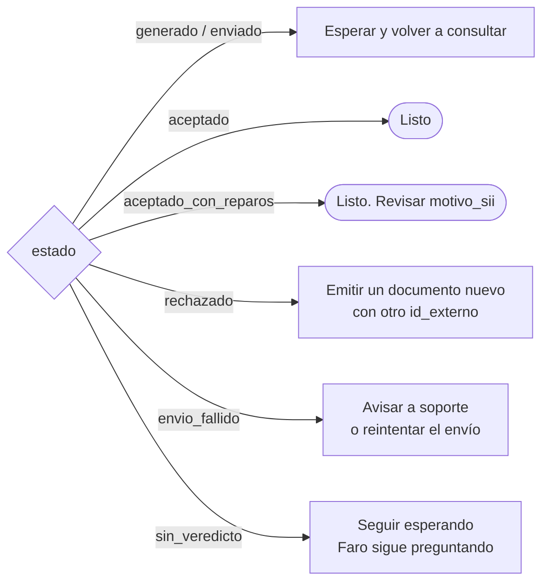
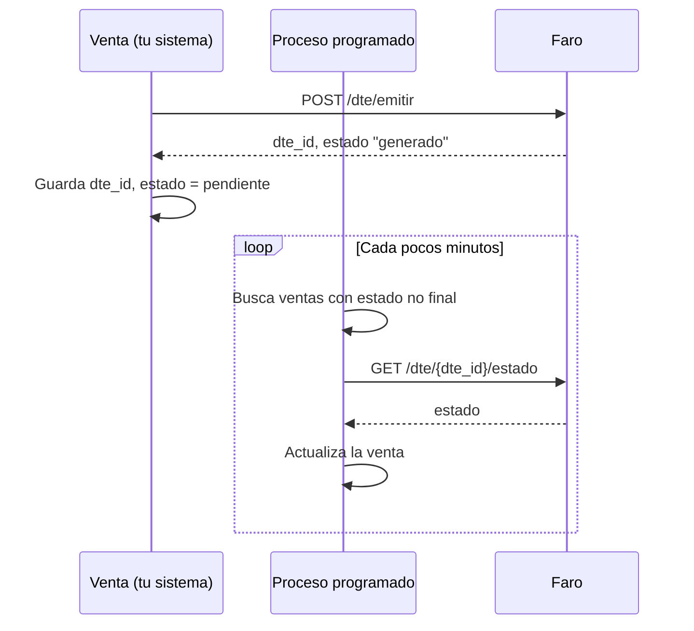

# Seguir el veredicto del SII

Después de emitir, Faro envía el documento al SII y le pregunta por el resultado hasta tenerlo.
Tu sistema solo lee ese resultado:

```http
GET /api/v1/dte/{dte_id}/estado
```

## La respuesta

```json
{
  "dte_id": 81,
  "tipo_dte": 33,
  "folio": 1042,
  "rut_emisor": "77777777-7",
  "estado": "aceptado",
  "track_id": "4242",
  "motivo_sii": null,
  "intentos_envio": 0,
  "enviado_en": "2026-11-09T10:15:02.120000",
  "consultado_en": "2026-11-09T10:21:40.553000",
  "veredicto_en": "2026-11-09T10:21:40.553000",
  "proxima_accion": null,
  "ambiente": "produccion",
  "envio_sii": "activo"
}
```

| Campo | Qué es |
|---|---|
| `estado` | Dónde está el documento. Es el campo que decide qué hace tu sistema. |
| `track_id` | El número de seguimiento que dio el SII al recibirlo. Sirve para buscarlo en el sitio del SII. |
| `motivo_sii` | Por qué fue rechazado o aceptado con reparos, o por qué falló el envío. |
| `intentos_envio` | Envíos fallidos seguidos (se vuelve a 0 cuando el SII lo recibe). |
| `enviado_en`, `consultado_en`, `veredicto_en` | Cuándo se envió, cuándo se preguntó por última vez y cuándo llegó el veredicto. |
| `proxima_accion` | Cuándo volverá Faro a enviar o a preguntar. |
| `envio_sii` | `activo` o `desactivado`: si la instancia envía al SII. |

## Qué hacer en cada estado



| `estado` | Significado | ¿Final? | Tu sistema |
|---|---|:-:|---|
| `generado` | Emitido y guardado; aún no sale al SII | No | Esperar |
| `enviado` | El SII lo recibió (hay `track_id`); falta el veredicto | No | Esperar |
| `aceptado` | El SII lo aceptó | **Sí** | Marcar la venta como facturada |
| `aceptado_con_reparos` | Aceptado, con observaciones | **Sí** | Igual que aceptado; revisar `motivo_sii` |
| `rechazado` | El SII lo rechazó. El folio queda inutilizado | **Sí** | Corregir y emitir uno nuevo. Ver [Corregir o anular](corregir-anular.md) |
| `envio_fallido` | Faro no logró que el SII lo recibiera tras varios intentos | No | Avisar; reintentar con `POST /dte/{dte_id}/enviar` |
| `sin_veredicto` | Pasaron 6 horas sin respuesta del SII | No | Esperar; si sigue así, revisar en el sitio del SII |

Detalle completo en [Estados](../referencia/estados.md).

## Cada cuánto consultar

Faro ya pregunta al SII por su cuenta, con esperas crecientes: a los 20 segundos del envío, luego
al minuto, a los 5, 15 y 30 minutos, y después cada hora. **Tu consulta lee lo que Faro ya
guardó**: es barata y no molesta al SII.

Una pauta razonable:

| Documento | Primera consulta | Luego |
|---|---|---|
| Boletas | 30 segundos después de emitir | Cada minuto durante 10 minutos; después cada 15 minutos |
| Facturas y notas | 2 minutos después de emitir | Cada 5 minutos la primera hora; después cada hora |

Deja de consultar cuando el estado sea **final** (`aceptado`, `aceptado_con_reparos` o
`rechazado`).

### Preguntar al SII en el momento

Si un usuario está mirando el documento y quiere el dato más fresco:

```http
GET /api/v1/dte/81/estado?consultar_sii=true
```

Faro pregunta al SII antes de responder. Para no saturar al SII, lo hace como mucho una vez cada
30 segundos por documento; dentro de ese plazo responde lo guardado. Úsalo para acciones de una
persona, no en procesos automáticos.

## Un patrón de implementación

Guarda el `dte_id` y el estado junto a cada venta, y deja que un proceso programado revise las
pendientes:



```python
FINALES = {"aceptado", "aceptado_con_reparos", "rechazado"}

def revisar_pendientes(ventas_pendientes, faro):
    for venta in ventas_pendientes:
        r = faro.get(f"/api/v1/dte/{venta.dte_id}/estado")
        r.raise_for_status()
        estado = r.json()["estado"]
        venta.actualizar(estado=estado, motivo=r.json()["motivo_sii"])
        if estado == "rechazado":
            avisar_rechazo(venta)          # hay que emitir un documento nuevo
        elif estado == "envio_fallido":
            avisar_soporte(venta)          # no salió al SII tras varios intentos
```

## Lo que conviene saber del SII

- **El veredicto es por documento.** El SII puede procesar un envío sin aceptar el documento que
  contiene. Faro mira el resultado de cada documento, así que `aceptado` significa aceptado.
- **El motivo de rechazo de una factura llega por correo.** El SII no lo entrega por su servicio
  de consulta, solo por correo electrónico a la empresa. En facturas, `motivo_sii` lo avisa; en
  boletas trae el detalle.
- **Un documento rechazado no se reenvía.** Su folio quedó usado. Ver
  [Corregir o anular](corregir-anular.md).
