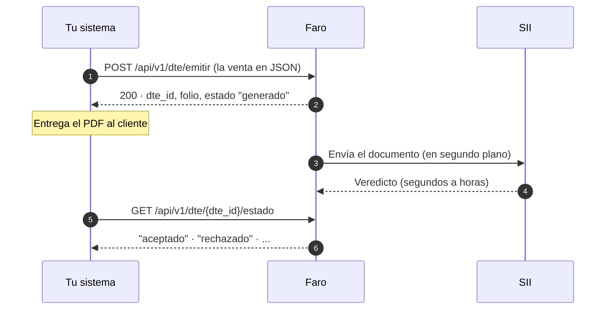

# Manual de la API de Faro

Faro es una API de facturación electrónica para Chile. Tu sistema (punto de venta, tienda web, ERP)
le envía los datos de una venta en JSON y recibe un documento tributario válido: folio, timbre,
firma, PDF para entregar y, en segundo plano, el veredicto del SII.

Este manual es para quien **conecta un sistema a Faro** y para quien **le da soporte**. No hace
falta conocer los formatos del SII: de eso se encarga Faro.

## Toda la integración en dos llamadas

1. **Emitir** responde al instante con el folio y el PDF timbrado.
2. **Consultar el estado** dice qué decidió el SII. Lo pides cuando lo necesites; Faro lo mantiene
   al día por su cuenta.

!!! info "¿Por qué no viene el veredicto en la misma respuesta?"
    El SII no valida en línea: recibe el documento, entrega un número de seguimiento (TrackID) y
    decide después. Lo explica [Cómo funciona](empezar/como-funciona.md).

## Por dónde empezar

-   **Cómo funciona**

    ---

    El modelo de Chile frente a otros países, los actores y el ciclo de un documento.

    [:octicons-arrow-right-24: Leer](empezar/como-funciona.md)

-   **Primeros pasos**

    ---

    Tu primera factura en un ambiente de prueba, en cinco minutos.

    [:octicons-arrow-right-24: Empezar](empezar/primeros-pasos.md)

-   **Guías**

    ---

    Emitir, seguir el veredicto, reintentar sin duplicar, corregir y anular.

    [:octicons-arrow-right-24: Ver guías](guias/emitir.md)

-   **Soporte**

    ---

    Síntoma, causa y qué hacer, para resolver casos sin leer código.

    [:octicons-arrow-right-24: Diagnóstico](soporte/diagnostico.md)

## Lo que necesitas saber antes de integrar

| | |
|---|---|
| **Una instancia por empresa** | Cada empresa tiene su propia instancia de Faro, en una red interna. Tu sistema la llama por una URL privada, por ejemplo `http://faro-acme:8000`. |
| **Autenticación** | Un token de integración por sistema, en `Authorization: Bearer`. No vence; se renueva. |
| **Formato** | JSON en UTF-8. Montos en pesos chilenos, enteros. Fechas `AAAA-MM-DD`. |
| **Mismas llamadas en prueba y producción** | Lo que cambia es la configuración de la instancia, no tu código. Ver [Ambientes](referencia/ambientes.md). |
| **Errores** | Siempre el mismo formato, con un `codigo` estable para tu programa. Ver [Errores](referencia/errores.md). |

!!! note "Datos de ejemplo"
    Todos los RUT, nombres y direcciones de este manual son ficticios.
