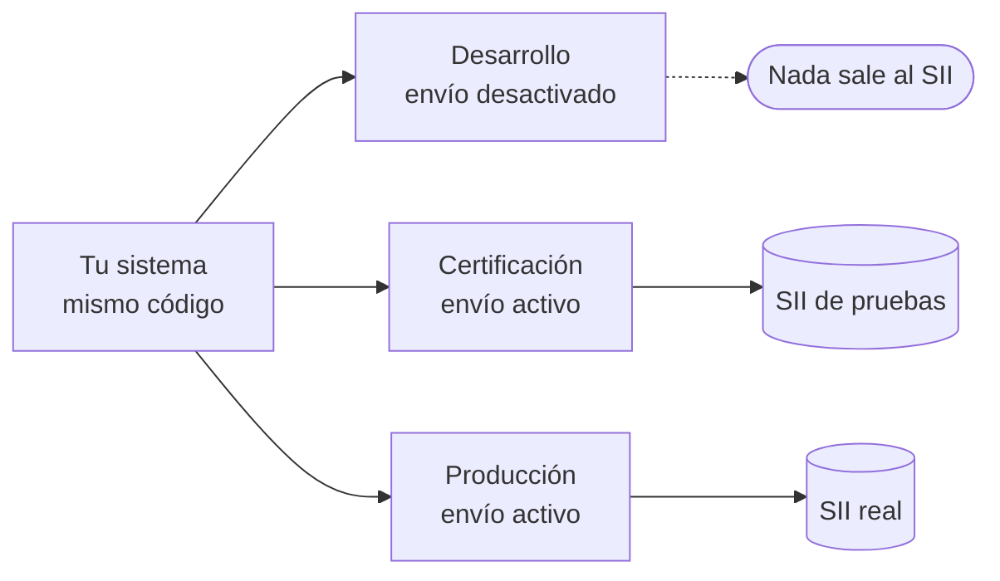

# Ambientes

Tu sistema usa **las mismas llamadas** en desarrollo, en pruebas con el SII y en producción. Lo
que cambia es la instancia de Faro a la que apunta.

| | Desarrollo | Certificación | Producción |
|---|---|---|---|
| **Para qué** | Construir y probar la integración | Probar contra el SII sin valor tributario | Operación real |
| **¿Envía al SII?** | No (`envio_sii: "desactivado"`) | Sí, al SII de pruebas | Sí, al SII real |
| **`envio` al emitir** | `desactivado` | `programado` | `programado` |
| **Estados que verás** | Siempre `generado` | Todos | Todos |
| **`ambiente` en las respuestas** | `certificacion` | `certificacion` | `produccion` |
| **Certificado y CAF** | De prueba | Reales, del ambiente de certificación | Reales, de producción |
| **Validez tributaria** | Ninguna | Ninguna | Sí |

## Qué probar en cada ambiente

**Desarrollo.** Todo lo que depende de tu sistema:

- [x] armar el JSON y leer las respuestas;
- [x] los errores de validación (`422`) y su presentación al usuario;
- [x] la idempotencia: repetir una emisión y recibir `repetido: true`;
- [x] descargar el PDF y el XML;
- [x] tu proceso de consulta de estados, que aquí siempre devuelve `generado`.

**Certificación.** Lo que depende del SII:

- [x] que los documentos pasen a `aceptado`;
- [x] el manejo de un `rechazado` (emitir un reemplazo);
- [x] los tiempos reales del veredicto;
- [x] notas de crédito y débito.

**Producción.** Empieza con un volumen bajo y vigila los estados las primeras semanas.

!!! warning "Antes de pasar a producción"
    - Que la empresa esté autorizada por el SII para emitir con este software.
    - Que tu sistema maneje `rechazado` y `envio_fallido` (alguien debe enterarse).
    - Que el token de producción sea distinto del de pruebas.

## Cómo saber en qué ambiente estás

Cada respuesta de emisión y de estado trae:

- `ambiente`: `certificacion` o `produccion`;
- `envio_sii` (en el estado): `activo` o `desactivado`.

Un buen hábito es registrarlos en tu sistema y mostrar un aviso visible cuando no sean los de
producción.
