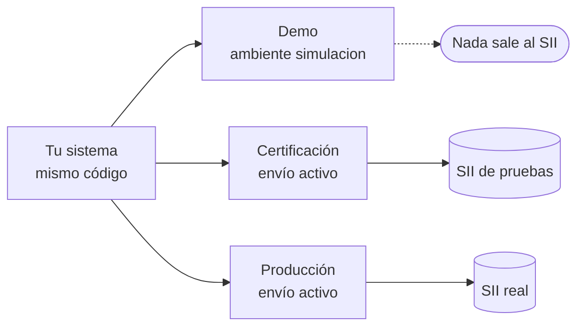

# Ambientes

Tu sistema usa **las mismas llamadas** en demo, en pruebas con el SII y en producción. Lo que
cambia es el ambiente de la empresa, que el administrador cambia en la misma instancia
([Pasar a producción](../guias/pasar-a-produccion.md)), y si la instancia envía o no al SII.

| | Demo | Certificación | Producción |
|---|---|---|---|
| **Para qué** | Aprender la API y construir la integración | Probar contra el SII sin valor tributario | Operación real |
| **¿Envía al SII?** | Nunca | Sí, al SII de pruebas | Sí, al SII real |
| **¿Se valida el RUT en el SII?** | No: basta un RUT bien formado | Sí, al entrar | Sí, y debe estar autorizado |
| **`envio` al emitir** | `simulacion` | `programado` | `programado` |
| **Estados que verás** | Siempre `generado` | Todos | Todos |
| **`ambiente` en las respuestas** | `simulacion` | `certificacion` | `produccion` |
| **Certificado** | De prueba | El real de la empresa | El real de la empresa |
| **CAF** | De prueba | Del ambiente de certificación del SII | De producción (otros archivos) |
| **Numeración** | Propia | Propia de certificación | Propia de producción: el folio 1 existe en los tres |
| **Validez tributaria** | Ninguna | Ninguna | Sí |

En certificación o producción, si la instancia tiene el envío apagado (`envio_sii:
"desactivado"`), `envio` responde `desactivado` y los documentos quedan en `generado`.

## Qué probar en cada ambiente

**Demo.** Todo lo que depende de tu sistema:

- [x] armar el JSON y leer las respuestas;
- [x] los errores de validación (`422`) y su presentación al usuario;
- [x] la idempotencia: repetir una emisión y recibir `repetido: true`;
- [x] descargar el PDF y el XML;
- [x] tu proceso de consulta de estados, que aquí siempre devuelve `generado`.

**Certificación.** Lo que depende del SII:

- [x] que los documentos pasen a `aceptado`;
- [x] el manejo de un `rechazado` (emitir un reemplazo);
- [x] los tiempos reales del veredicto;
- [x] notas de crédito y débito.

**Producción.** Empieza con un volumen bajo y vigila los estados las primeras semanas.

!!! warning "Antes de pasar a producción"
    - Que la empresa esté autorizada por el SII para emitir con este software.
    - Que tu sistema maneje `rechazado` y `envio_fallido` (alguien debe enterarse).
    - Que el CAF de producción esté cargado: los de certificación no sirven.

## Cómo saber en qué ambiente estás

Cada respuesta de emisión y de estado trae:

- `ambiente`: `simulacion`, `certificacion` o `produccion`, el ambiente en que nació el documento;
- `envio_sii` (en el estado): `activo` o `desactivado`.

`GET /api/v1/empresa` dice el ambiente actual de la empresa.

Un buen hábito es registrarlos en tu sistema y mostrar un aviso visible cuando no sean los de
producción.
