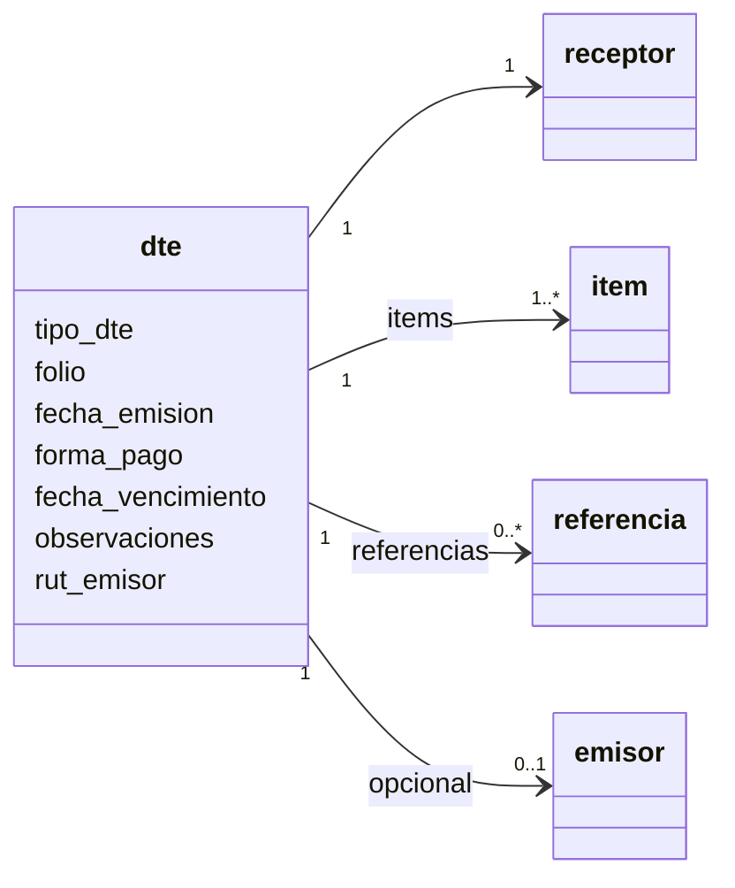

# El documento (JSON)

El objeto `dte` que va en [`POST /dte/emitir`](../guias/emitir.md) y en
[`POST /dte/previsualizar`](../guias/previsualizar.md).

## `dte`

| Campo | Tipo | Obligatorio | Descripción |
|---|---|:-:|---|
| `tipo_dte` | entero | sí | 33, 34, 39, 41, 56 o 61. Ver [tipos](../guias/emitir.md#tipos-de-documento) |
| `receptor` | objeto | sí | A quién se emite. Ver [`receptor`](#receptor) |
| `items` | lista | sí (1 o más) | Lo que se vende. Ver [`items`](#items) |
| `referencias` | lista | en 56 y 61 | Documento que se corrige. Ver [`referencias`](#referencias) |
| `fecha_emision` | fecha | no (hoy) | `AAAA-MM-DD` |
| `forma_pago` | entero | no (`1`) | `1` contado · `2` crédito · `3` sin costo |
| `fecha_vencimiento` | fecha | no | Para ventas a crédito |
| `observaciones` | texto (1000) | no | Texto libre impreso en el documento |
| `indicador_servicio` | entero | no | `1` a `3`, para boletas de servicios periódicos |
| `rut_emisor` | texto | no | Qué empresa emite, si la instancia tiene varias |
| `emisor` | objeto | no | Datos del emisor. Si no lo mandas, se usan los configurados |
| `folio` | entero | no | No lo mandes: Faro asigna el siguiente |

## `receptor`

| Campo | Tipo | Obligatorio | Descripción |
|---|---|:-:|---|
| `rut` | texto | sí | Sin puntos y con guion: `76111111-6`. Consumidor final sin identificar: `66666666-6` |
| `razon_social` | texto (100) | sí | Nombre o razón social. Consumidor final: `CONSUMIDOR FINAL` |
| `giro` | texto (80) | en facturas | Actividad del receptor |
| `direccion` | texto (80) | en facturas | |
| `comuna` | texto (20) | en facturas | |
| `ciudad` | texto (20) | no | |
| `email` | texto (80) | no | |
| `es_contribuyente` | booleano | no (`true`) | `false` para personas sin inicio de actividades (boletas) |

## `items`

| Campo | Tipo | Obligatorio | Descripción |
|---|---|:-:|---|
| `numero_linea` | entero | sí | 1, 2, 3… en orden |
| `nombre` | texto (80) | sí | Nombre del producto o servicio |
| `precio_unitario` | número | sí | **Neto** en facturas y notas; **con IVA** en boletas |
| `cantidad` | número | no (`1`) | Admite decimales |
| `descripcion` | texto (1000) | no | Detalle adicional |
| `unidad_medida` | texto (4) | no | `UN`, `KG`, `HR`… |
| `descuento_pct` | número | no | Descuento en porcentaje (0 a 100) |
| `descuento_monto` | número | no | Descuento en pesos. Tiene prioridad sobre `descuento_pct` |
| `exento` | booleano | no (`false`) | Ítem sin IVA dentro de una factura afecta |
| `codigo_producto` | texto (35) | no | Tu código interno (SKU) |

## `referencias`

| Campo | Tipo | Obligatorio | Descripción |
|---|---|:-:|---|
| `tipo_doc_ref` | entero | sí | Tipo del documento referenciado |
| `folio_ref` | entero | sí | Su folio |
| `fecha_doc_ref` | fecha | sí | Su fecha de emisión |
| `codigo_ref` | entero | no (`1`) | `1` anula · `2` corrige texto · `3` corrige montos |
| `razon_ref` | texto (90) | no | Motivo |
| `numero_linea` | entero | no (`1`) | Orden, si hay varias referencias |

Ver [Corregir o anular](../guias/corregir-anular.md).

## `emisor` (opcional)

Solo si quieres reemplazar los datos configurados de la empresa. Si lo mandas, va completo:

| Campo | Tipo | Obligatorio |
|---|---|:-:|
| `rut` | texto | sí |
| `razon_social` | texto (100) | sí |
| `giro` | texto (80) | sí |
| `codigo_actividad` | entero | sí |
| `direccion` | texto (80) | sí |
| `comuna` | texto (20) | sí |
| `ciudad` | texto (20) | sí |
| `telefono` | texto (20) | no |
| `email` | texto (80) | no |

## Convenciones

- **RUT:** sin puntos, con guion y dígito verificador: `12345678-5`. Faro valida el dígito.
- **Montos:** pesos chilenos. Faro redondea a enteros.
- **Fechas:** `AAAA-MM-DD`.
- **Textos:** se recortan los espacios al inicio y al final. Respeta los largos máximos: un texto
  más largo responde `422`.
