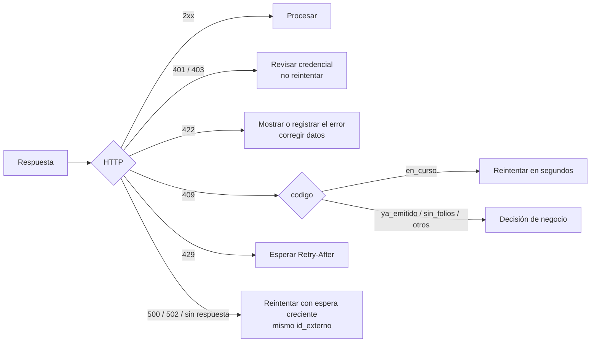

# Errores

Todas las respuestas de error tienen el mismo formato:

```json
{
  "error": {
    "codigo": "sin_folios",
    "mensaje": "No quedan folios T33 disponibles",
    "detalle": {"tipo_dte": 33},
    "request_id": "d2b6f0f0bb8a"
  }
}
```

| Campo | Para qué |
|---|---|
| `codigo` | Identificador estable. **Tu programa decide por este campo**, no por el texto ni solo por el HTTP. |
| `mensaje` | Explicación en español, para personas. Puede cambiar de redacción. |
| `detalle` | Datos adicionales: errores de validación, folio, `dte_id`… (puede no venir) |
| `request_id` | Identificador de la petición. También viene en la cabecera `X-Request-ID`. |

!!! tip "Cita el `request_id` al pedir soporte"
    Con ese valor, quien opera la instancia encuentra tu petición exacta en los registros del
    servidor. Si tu sistema manda su propia cabecera `X-Request-ID`, Faro la reutiliza.

## Códigos

| `codigo` | HTTP | Significado | ¿Reintentar? |
|---|:-:|---|---|
| `validacion` | 422 | Datos inválidos: RUT, montos, campos faltantes, largo excedido, esquema del SII. Los errores vienen en `detalle.errores` | No: corrige los datos |
| `autenticacion` | 401 | Token ausente, incorrecto, renovado o revocado | No: revisa el token |
| `autorizacion` | 403 | El token no tiene permiso para esa ruta | No |
| `no_encontrado` | 404 | El documento, CAF o certificado no existe (o no es de tu token) | No |
| `conflicto` | 409 | El estado actual impide la operación | No |
| `en_curso` | 409 | Otra petición está emitiendo la misma venta o enviando el mismo documento | **Sí**, en unos segundos |
| `ya_emitido` | 409 | El `id_externo` ya tiene un documento con otros datos. `detalle` trae `dte_id`, `folio` y `estado` | No. Ver [Idempotencia](../guias/idempotencia.md) |
| `sin_folios` | 409 | No quedan folios para ese tipo | Después de cargar un CAF |
| `folio` | 409 | Folio fuera de rango, ya usado, o no hay CAF para el tipo | No |
| `envio_desactivado` | 409 | Se pidió enviar al SII en una instancia que no envía | No. Ver [Ambientes](ambientes.md) |
| `caf` | 422 | El CAF es inválido, está dañado, es de otra empresa o de otro tipo | No |
| `certificado` | 422 | El certificado no carga: contraseña incorrecta o vencido | No: subir uno vigente |
| `demasiadas_solicitudes` | 429 | Demasiados intentos fallidos de autenticación | Después de `Retry-After` |
| `sii_comunicacion` | 502 | El SII no respondió (red, caída, tiempo agotado) | **Sí**. En envíos automáticos, Faro ya reintenta |
| `sii_rechazo` | 422 | El SII rechazó la operación. `detalle.codigo_sii` trae el código del SII | No |
| `error_emision` | 500 | Falló la generación después de reservar el folio. `detalle` trae `dte_id` y `folio` | **Sí**, con el mismo `id_externo` |
| `error_interno` | 500 | Error inesperado del servidor | Sí, con espera; si persiste, avisar con el `request_id` |

## Errores de validación

Un `422 validacion` explica cada problema en `detalle.errores`:

```json
{
  "error": {
    "codigo": "validacion",
    "mensaje": "Los datos del documento no son válidos.",
    "detalle": {
      "errores": [
        "El RUT del receptor no es válido: 76111111-0",
        "Una nota de crédito o débito (56/61) debe referenciar el documento que corrige: falta `referencias`."
      ]
    },
    "request_id": "4f0a1c2b9e77"
  }
}
```

Los errores de validación **nunca gastan un folio**.

## Cómo manejar los errores en tu sistema


