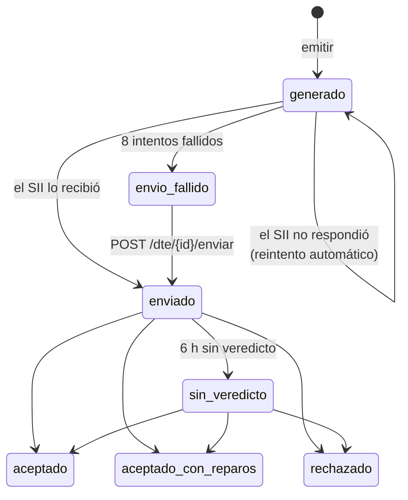

# Estados

El campo `estado` de `GET /api/v1/dte/{dte_id}/estado` dice dónde está cada documento.

## Tabla de estados

| `estado` | Significado | ¿Final? | Qué hace Faro | Qué hace tu sistema |
|---|---|:-:|---|---|
| `generado` | Timbrado y guardado. Aún no sale al SII | No | Lo envía (si la instancia envía al SII) | Esperar. El PDF ya se puede entregar |
| `enviado` | El SII lo recibió y entregó un `track_id`. Falta el veredicto | No | Pregunta al SII con esperas crecientes | Esperar |
| `aceptado` | El SII lo aceptó | **Sí** | Nada más | Marcar como facturado |
| `aceptado_con_reparos` | Aceptado con observaciones (en `motivo_sii`) | **Sí** | Nada más | Igual que aceptado; revisar el motivo |
| `rechazado` | El SII lo rechazó (motivo en `motivo_sii`). El folio queda inutilizado | **Sí** | Lo lista para anular el folio | Emitir uno nuevo con otro `id_externo` |
| `envio_fallido` | El SII no lo recibió tras 8 intentos | No | Deja de reintentar solo | Avisar a soporte; reintentar con `POST /dte/{id}/enviar` |
| `sin_veredicto` | 6 horas después del envío, todavía sin veredicto | No | Sigue preguntando cada hora | Esperar; si dura, revisar en el sitio del SII |

!!! info "Valores por defecto"
    Los 8 intentos y las 6 horas son la configuración por defecto de la instancia. El
    administrador puede ajustarlos.

## Reintentos de envío

Si el SII no responde al enviar, el documento **sigue en `generado`** y Faro reintenta con esperas
crecientes: 1, 2, 4, 8, 16, 32 y 60 minutos. Durante ese tiempo:

- `intentos_envio` cuenta los fallos;
- `motivo_sii` dice el último error;
- `proxima_accion` dice cuándo será el próximo intento.

Al octavo fallo pasa a `envio_fallido`. Cuando el SII lo recibe, `intentos_envio` vuelve a 0.

## Seguimiento del veredicto

Después del envío, Faro pregunta al SII a los 20 segundos, al minuto, a los 5, 15 y 30 minutos, y
luego cada hora, hasta tener un veredicto.

## Cómo decide Faro el veredicto

El SII responde en dos niveles: si **procesó el envío** y qué decidió de **cada documento**. Faro
usa solo el segundo:

| El SII informa del documento | Estado en Faro |
|---|---|
| Rechazado | `rechazado` |
| Rechazó el envío completo (por ejemplo, firma o esquema) | `rechazado` |
| Aceptado con reparos | `aceptado_con_reparos` |
| Aceptado | `aceptado` |
| Envío procesado, sin desglose todavía | Sigue `enviado` |

!!! warning "Envío procesado no es aceptado"
    Que el SII diga que procesó el envío no significa que aceptó el documento. Si consultas el
    TrackID por tu cuenta en el sitio del SII, mira el resultado del documento, no el del envío.

## Estado del documento y envío al SII

El campo `envio_sii` de la respuesta dice si la instancia envía documentos al SII:

- `activo`: los documentos avanzan por los estados de esta página.
- `desactivado`: instancia de pruebas. Los documentos se quedan en `generado`. Ver
  [Ambientes](ambientes.md).
