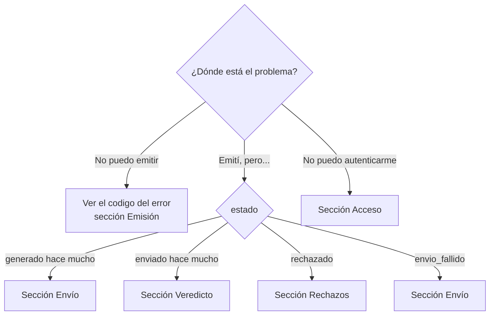

# Diagnóstico de problemas

Guía para resolver casos de soporte a partir del síntoma. Antes de empezar, reúne:

- el `dte_id` o el folio y tipo del documento;
- el `request_id` del error (viene en la respuesta y en la cabecera `X-Request-ID`);
- la respuesta de `GET /api/v1/dte/{dte_id}/estado`.

## Acceso

| Síntoma | Causa probable | Solución |
|---|---|---|
| `401 autenticacion` en todas las llamadas | Token mal copiado, renovado o revocado | Confirmar con `GET /api/v1/auth/me`. Si se renovó, usar la clave nueva; si se revocó, pedir otro |
| `401` justo después de renovar | La configuración sigue con la clave anterior | Actualizar el secreto en el sistema |
| `403 autorizacion` | El token llama una ruta de administrador | Usar la ruta equivalente para integraciones o pedir la acción al administrador |
| `404` en un documento que sí existe | El documento lo emitió **otro** token | Consultarlo con el token que lo emitió |
| `429 demasiadas_solicitudes` | Muchos intentos fallidos desde esa IP | Esperar `Retry-After`; corregir el token antes de reintentar |
| No conecta (tiempo agotado, conexión rechazada) | Tu sistema no está en la red interna de la instancia, o la URL es incorrecta | Verificar la URL y la red con el administrador |

## Emisión

| Síntoma | Causa probable | Solución |
|---|---|---|
| `422 validacion` con "RUT … no es válido" | Dígito verificador incorrecto o formato con puntos | Enviar `12345678-5`, sin puntos |
| `422 validacion` con "faltan datos del emisor" | La empresa no tiene completos sus datos | Completar con `PUT /api/v1/keystore/negocios/{id}`; los campos faltantes vienen en `detalle.faltan` |
| `422 validacion` "varios negocios" | La instancia tiene más de una empresa | Agregar `rut_emisor` al `dte` |
| `422 validacion` "esquema del SII (XSD)" | Un dato no cumple el formato del SII (largo, caracteres) | Revisar `detalle.errores` |
| `422 validacion` en una nota | Falta `referencias` | Agregar la referencia al documento original |
| `409 sin_folios` | Se acabaron los folios del tipo | Cargar un CAF nuevo (`POST /api/v1/caf`) |
| `409 ya_emitido` | El `id_externo` se reutilizó con otros datos | Ver [Idempotencia](../guias/idempotencia.md#ya_emitido-la-venta-cambio-despues-de-emitir) |
| `409 en_curso` repetido por más de un minuto | Una emisión quedó a medias | Reintentar con el mismo `id_externo`; si persiste, avisar al administrador |
| `422 certificado` | Certificado vencido o contraseña cambiada | Subir el certificado vigente y asociarlo a la empresa |
| Totales distintos a los de tu sistema | Precio con IVA en una factura, o sin IVA en una boleta | Factura y notas: precio neto. Boleta: precio con IVA |

## Envío

| Síntoma | Causa probable | Solución |
|---|---|---|
| `envio: "desactivado"` y el estado no avanza de `generado` | Instancia de desarrollo: no envía al SII | Esperado. Ver [Ambientes](../referencia/ambientes.md) |
| `generado` con `intentos_envio` > 0 | El SII no respondió; Faro está reintentando | Esperar. `motivo_sii` dice el error y `proxima_accion` el próximo intento |
| `envio_fallido` con `motivo_sii` sobre el certificado | Certificado vencido o inválido | Reemplazar el certificado y reintentar con `POST /api/v1/dte/{id}/enviar` |
| `envio_fallido` con error de red o del SII | Caída prolongada del SII o de la red | Confirmar que el SII opera y reintentar con `POST /api/v1/dte/{id}/enviar` |
| `envio: "no_solicitado"` y sigue en `generado` | Se emitió con `"enviar": false` | Enviar con `POST /api/v1/dte/{id}/enviar` |

## Veredicto

| Síntoma | Causa probable | Solución |
|---|---|---|
| `enviado` durante minutos | Normal en facturas | Esperar; Faro sigue preguntando |
| `sin_veredicto` | El SII lleva más de 6 horas sin resolver | Faro sigue preguntando. Buscar el `track_id` en el sitio del SII; si el SII lo resolvió, `?consultar_sii=true` lo actualiza |
| El sitio del SII dice "procesado" pero Faro sigue en `enviado` | "Procesado" se refiere al envío, no al documento | Esperar el resultado del documento |

## Rechazos

| Síntoma | Causa probable | Solución |
|---|---|---|
| `rechazado` en una boleta | El detalle viene en `motivo_sii` | Corregir y emitir una nueva con otro `id_externo` |
| `rechazado` en una factura sin detalle | El SII manda el detalle **solo por correo** a la empresa | Revisar el correo registrado en el SII; corregir y emitir una nueva |
| Varios rechazos seguidos | Configuración: certificado, autorización o datos de la empresa | Escalar al administrador antes de seguir emitiendo |

Un documento rechazado **no se reenvía** y su folio queda inutilizado. Ver
[Corregir o anular](../guias/corregir-anular.md).

## Cuándo escalar al administrador

- Errores `500` repetidos (con su `request_id`).
- `envio_fallido` o `sin_veredicto` en varios documentos a la vez.
- Rechazos repetidos con el mismo motivo.
- Folios por agotarse sin un CAF de reemplazo.
- Un certificado próximo a vencer.
